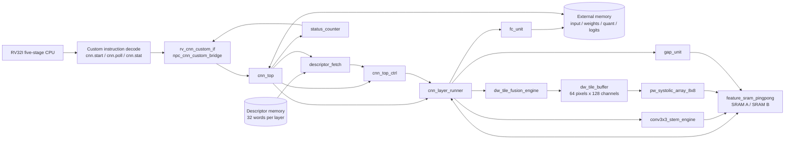
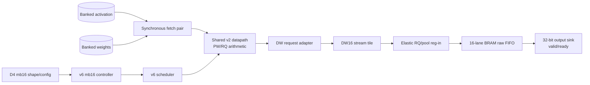
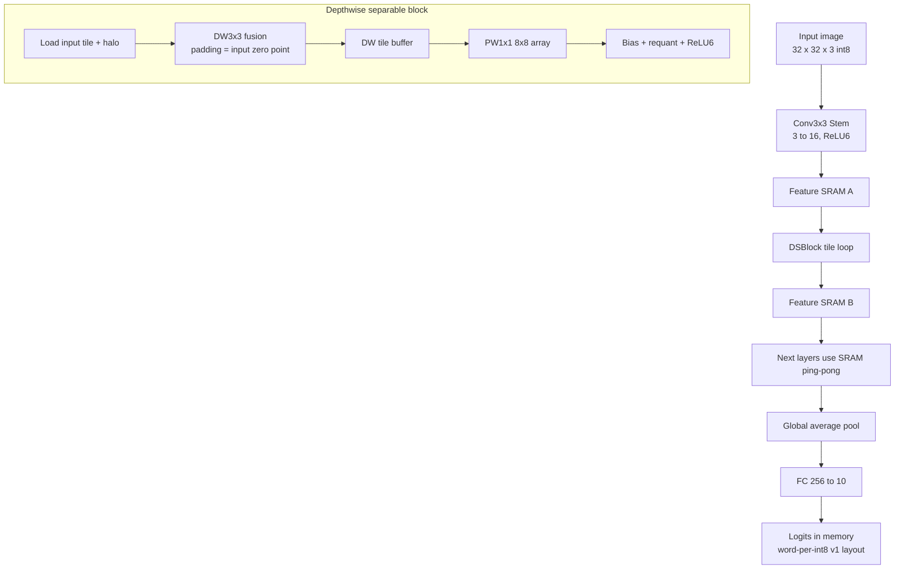

# Architecture and Verification Diagrams

> **Snapshot (2026-09-11)**: The first diagrams show the C0 production/frozen
> control path. D4 is a separate network mainline and currently exists only as
> software-frozen plus standalone/OOC vstream RTL; it has not replaced
> `cnn_top`. See [`project_evolution_20260911.md`](project_evolution_20260911.md)
> and [`reports/README.md`](reports/README.md).

This note keeps the project diagrams in text form so they can be versioned, reviewed, and copied into reports or slides.

## Accelerator Architecture

Key point: DW3x3 intermediate data is not written back to external memory. The DW tile output is kept in `dw_tile_buffer`, then consumed by PW1x1.

## D4 retained standalone/OOC architecture

This block has exact no-BP/random/final-stall/two-epoch regressions and a
fully routed OOC wrapper. It does not include all D4 shapes, GAP, FC, complete
logits, firmware or a D4 full-top.

## Datapath View

## Verification Closure

```mermaid
flowchart LR
    TORCH[PyTorch / Numpy training] --> EXPORT[quantize_export.py<br/>int8 weights, bias, qparams]
    EXPORT --> GOLDEN[golden_int8.py<br/>bit-exact software model]
    GOLDEN --> VEC[generate_test_vectors.py<br/>descriptor + memory image + expected]
    VEC --> RTL[RTL testbenches]
    RTL --> VERILATOR[Verilator simulation]
    VERILATOR --> CMP[logits compare<br/>expected vs actual]
    CMP --> FW[Firmware / CPU joint sim<br/>custom start, poll, stat]
    FW --> REPORT[accuracy + cycle reports]
    REPORT --> IMPL[XC7Z020 synth / place / route]
    IMPL --> PPA[timing + resources + power]
    PPA --> ENERGY[same-source latency / energy / GOPS/W]
```

Current C0 full-network checks compare all 10 logits element by element, then
check the CPU-observed argmax path. D4 has not yet reached the full-network,
firmware or full-top nodes in this closure graph.
