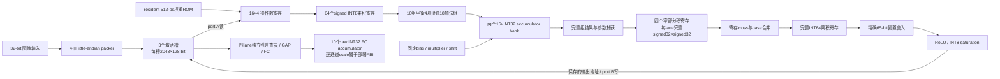
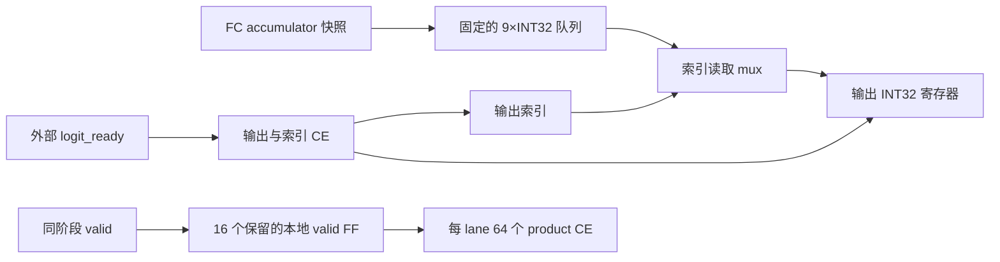

# 完整 D4：网络与硬件结构

当前研究实现保持冻结 D4 网络、权重和 INT8/INT32 运算语义：204,090 参数、
10 个 MBConv、41 个算子，每次推理 11,645,440 semantic MAC / 23,290,880 ops。
历史 official test10k INT8 top-1 为91.46%；本轮核对冻结软件源哈希，未重跑test10k。
完整 RTL 的数值证据来自十类别输入、四个边界输入及全部中间结果逐字精确比较。
最新完整功能候选为P（外部latency258,814/interval258,816），最新完整物理结果为P同步125MHz通过（WNS +.128/WHS +.010）；L2对L的数据寄存器
采用valid使能并已通过完整功能验证和完整综合（WNS -1.051ns）；M增加单入口寄存启动token，完整P&R后负setup；N等价halo边界化已通过完整功能门，O仅去掉冗余logit_ready输入reset门控，已通过完整功能门与新增ready/reset探针，同源综合WNS -1.017ns、内部+.632ns，完整P&R WNS -.221ns/WHS +.049ns，setup仍失败；P静态FC队列/本地CE功能与综合拓扑通过，综合setup+.106ns/hold-.155ns，完整P&R同步时序+.128/+.010ns通过，复位后数字overwrite-before-read通过，物理reset warning保留，sample0 native估算0.613W/18.35GOPS/W（Medium），初始20目标未过。下图表示L/L2共用算术结构，不能沿用K2资源数字作为L/L2的PPA。

## 连续组数据流

卷积持续发射，不在每组之间排空MAC、等待量化、再重新启动。两bank轮换，
一组的结果进入量化时，下一组已经在MAC流水中；有效位、首末标志、bank、
通道尾部和输出地址随各级数据前进。最后一个输出真正写回后才切换算子。
FC保留原始INT32累加器输出，不能直接按raw accumulator求argmax。
当前周期证据从外部start握手计到10个raw FC交付后的done；未测主机图像预处理、逐通道scale重建和分类延迟，不能将其视为0或声称板级端到端延迟已验证。14组冻结向量的140个float64 logits及argmax已由raw FC和ABI scales逐项重建核对，见`build/reports/d4_m_fc_output_abi_20261018.json`。

冻结网络的PW最小输入通道数使每输出组至少有4个读/乘发射周期；stem与DW各有
9个tap。K=4时，旧组结果捕获与同bank新组参数装入可以在同一时钟边沿发生，
非阻塞赋值保证捕获旧值，新组首次累加在后续流水级发生。该约束是双bank
设计成立的网络条件，不声称它适用于任意更小的K。仿真同时检查bank所有权。

CONV的src_slot与dst_slot在冻结图中均不同，允许port A读与port B提交同时进行。
ADD/GAP/IMAGE使用各自的互斥协议；两个RAM端口都用明确地址mux及同步READ_FIRST
模板。功能正确并不自动保证可推断BRAM：旧J端口写法的全网综合已被拒绝，
修正模板的独立probe、K2全网综合与post-route均为32个RAMB36E1。

## 保持精确值的表示与流水

量化采用与原nearest-away-from-zero等价的偏置式。shift非零时，先在65-bit中
计算`x + 2^(shift-1) - (x<0)`，再算术右移；shift=0时偏置为0。额外一位覆盖
正数在shift=63时的加法溢出。该等价式经过1,292,544个RTL单位测试，并随完整
网络回归验证，没有改变舍入规则。

残差两分支仍各自查表完成缩放与舍入，然后相加并饱和。冻结的3,584个32-bit
表项都在[-142,141]，signed9可逐项无损还原；两项之和在signed10内。四份双端口
窄表每周期发射四lane，查表、求和与饱和分级。全表、七个ADD的全部地址范围与
458,752个输入对验证了其与32-bit参考的精确等价性。这是无损存储与并行度调整。

固定权重与bias还给出全部signed INT8输入下的保守累加器界：
[-43,658,799, 1,213,954]，最多需27个signed位；RTL仍保留INT32 accumulator。
每项乘积的最小贡献非正、最大贡献非负，因此该界也覆盖中途部分和。
证明入口为`tests/verify_d4_accumulator_bounds.py`，不依赖校准样本的观测范围。

## 时钟与证据边界

125MHz物理输入经IBUF、MMCME2_BASE和core BUFG；反馈另用BUFG，M8/D1/O8、
VCO1000MHz、相位0。约束仅建立8ns physical primary，core/feedback由原语推导，
保持1:1时钟关系与0.2ns uncertainty；没有false path或multicycle放宽。
外部receiver假设setup1ns、hold0.2ns，output delay分别为+1/-0.2ns。
这些是原型接口假设，没有板级LOC、bitstream或上板测量结论。

外部reset或失锁异步清零复位同步器，core时钟两级同步释放；operational使用
同步器最后一级Q。失锁时中止当前推理；输入时钟恢复后需要外部reset再重锁。
真实UNISIM测试覆盖这些情形，通用仿真模型本身不检测停钟。

L功能候选为258,813 cycles、连续启动间隔258,815 cycles，含start后的全部
4,096个输入beat。每次检查24,336个中间字、10个FC accumulator及完整MAC账本。
两项相对K2均增加64cycles：32个CONV各多2cycles排空，MAC发射、其他算子与
输入账本不变。原K2修正RAM模板后通过完整功能回归，全网综合为20,377 LUT、11,173 FF、
93 BRAM与64 DSP，资源最高为BRAM的66.43%。综合WNS为-0.504ns，不能作为
125MHz闭合证据。完整post-route为20,214 LUT、11,155 FF、93 BRAM与64 DSP，
WNS -0.990ns、WHS +0.005ns、0 routing errors，setup仍失败；活动功耗仍需
独立验收，不能沿用旧E的数字。
实际工作频率、能量与GOPS/W只使用同源post-route结果和真实启动间隔。
20GOPS/W等价于每次推理能量≤1.164544mJ，运算量口径保持不变。

## 后续设计的选择依据

K2相对E把完整推理从527,355降到258,749 cycles，主要收益来自连续输出组
与四lane残差，而非网络裁剪。K2的32个CONV合计230,432 cycles，其中230,016
为发射，仅416为逐算子排空开销；再压缩组间控制已经不可能取得上一轮的收益。
按真实MAC计算平均45.007 MAC/cycle，约为64 MAC/cycle峰值的70.3%。
这与88.90%的发射时间占比不同，后者仍含DW和通道尾部的空lane。

本轮post-route最差内部路径从state到RQ DSP PCIN，-0.990ns；最差外部路径
从done_ready到state CE，-0.663ns。因此下一候选L已选定精确32×32部分积流水，
以及独立于主计算状态的完成token；地址等metadata同步延长。L完整功能门已
通过，L2在同一算术结构上按valid使能数据寄存器，也已通过完整功能门；L2/M综合均已完成但负setup，M完整P&R为WNS -.287ns/WHS +.006ns，setup仍失败；O post-route WNS -.221ns/WHS +.049ns仍失败；P后续物理结果+.128/+.010ns通过同步时序门。
所有候选先通过完整exact，再综合检查资源和存储推断，
最后只为选定候选进行完整布线。

K2 checkpoint已核实0.05ns input jitter、8ns主/生成时钟和0.2ns uncertainty。
check_timing常规缺约束检查为0，但报告另有87个max/87个min的异步复位相关
未定时端点，最差示例从无时钟的MMCM LOCKED到复位同步器CLR；其无穷slack
不能作为恢复/移除通过。两级同步器均ASYNC_REG=1、SHREG_EXTRACT=NO，并同处
SLICE_X113Y76。该架构依赖异步断言复位、同步释放，未建立全局形式化CDC或
亚稳态测量证据；不能把常规check_timing为0解释为每个恢复/移除端点都已定时。

资源方面，93/140 BRAM只比严格70%上限少5个完整tile。平坦6144×128激活
存储当前向8192深度映射，用32个tile；显式三个2048深度槽的理论容量为24个。
按槽组织双端口是候选方向，尚无实现或推断证据；必须覆盖ADD双源读、CONV
同时读写和槽选择时序，不能直接把理论8个tile节省写成测量结果。

在已闭合125MHz且间隔保持258,751 cycles的条件下，吞吐为约483.09次/秒，
真实算术吞吐约11.252 GOPS，因此20GOPS/W要求总片上功耗不高于约0.56258W。
这些仅为评价边界，不是K2实测性能。应先取得同源活动估算，再决定是否改变
MAC映射、存储或并行度。网络修改需另立accuracy/ops基线，并与冻结D4保留对照。

阶段结果、失败证据和最新进展见
[完整开发记录](reports/d4_fullnet_development_20261018.md)。

## P：输出存储访问与局部 valid 的实现边界

P 保留原 FC_LOAD 的 9 个后续 accumulator 快照，把 ready 驱动的队列移位改成按当前输出索引读取。队列只在加载快照时写，外部停顿只控制输出寄存器和索引；数据选择多了索引 mux，因此必须同时检查内部数据路径与输入 CE 路径。完整功能回归已确认 10 个 raw INT32 输出顺序、各停顿模式、复位重启与周期均同 O。综合中队列独立 CE 网驱动 288 个 FF，输出 CE 网驱动 40 个 sink；O 的二者共享网为 292。该变化主要解决控制扇出，不能据此宣称整网功耗大幅下降。

各 RQ lane 的 merge_valid 数值时序相同，综合曾把它们合并成驱动跨 lane product CE 的控制网。P 仅保留这些关键 FF（DONT_TOUCH），以少量局部控制寄存器换取独立布线机会，保留其它算术和层次优化。真实综合检查得到 16 个目标 FDRE，每路直接驱动同 lane 的 64 个 product CE；宽泛名称匹配中的 LUT 和 core-level valid 另行区分。该属性的价值取决于最终布线结果，不能仅由 RTL 中出现 16 个 generate 实例证明。

以上为 P 已接受功能、综合及真实post-route拓扑；P同步125MHz时序通过，BRAM复位后的数字overwrite-before-read已通过，物理reset warning保留，sample0活动功耗已完成：0.613W/18.35GOPS/W（Medium），20初始目标未过。综合 LUT/FF 相较 O 的减少是组合候选与工具优化的总结果，不单独归因于某一行修改。网络精度、语义 MAC、cycle 边界和外部时序约束均保持。
