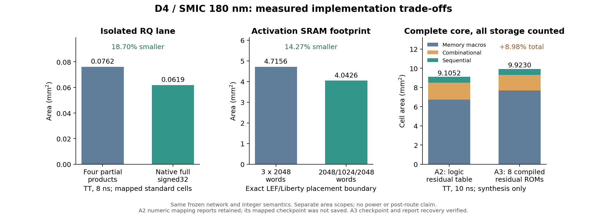

# D4 ASIC development evidence (2026-10-20)

ASIC migration is active. Complete-network functionality using real SMIC SRAM
and ROM models and complete-core mapping are established. The current A3
reset-preserving mapping now passes an error-free native logic proof and eight
complete mapped-gate inferences. Physical implementation is a separate gate.
No complete ASIC power/energy result is claimed.

## Current checkpoint after resumed execution

The current A3 synchronous-reset-preserving mapping passes eight complete
mapped-netlist inferences: two inputs (sample0 and synthetic checkerboard), two
stall modes (0 and 2), and two epochs. Each checks 24,336 intermediate words,
10 raw FC values and 11,645,440 semantic MAC. Mode0 takes 255,740 cycles; mode2
takes 257,890 and 257,818 cycles. These use the real memory models and the
standard-cell library's default specify propagation arcs, with timing checks
disabled and no SDF. They establish functional behavior, not routed frequency.
The earlier four failures with `+define+functional` remain negative simulation
evidence; that mode removes propagation delays needed by the memory-model
sampling interaction. No DUT initialization or memory-model patch was used.

The shared core-first PG construction passes on the original A3 placed,
pre-CTS checkpoint: 19 macros and 38 PG terminals, zero special-routing DRC,
and zero VDD/VSS connectivity errors or warnings. Root acceptance binds the
eight-file archive to that checkpoint. This is a construction component test,
not a routed result for the new mapping. The corrected full implementation is
the next separate gate; its current new-mapping pre-CTS PG check also passes.
The old routed hold/DRC failures remain valid negatives.

Under the same reset-preserving synthesis policy, A2 area is 9.147690069 mm2
and A3 area is 9.967994545 mm2, including their respective macros. TT10ns
synthesis setup slack is +0.000479698 and +0.0000429153 ns respectively. These
new mappings must not inherit the old mappings' physical or proof acceptance.

The new A2 mapping now independently passes the same eight exact mapped-gate
inferences and startup probe. Its mode0/mode2 metrics equal A3 exactly; its
frozen identity records the mapped netlist, scoreboard, runner, vector inputs
and 19 loaded simulation-model file hashes. Root acceptance of
`d4_asic_A2_sync_gate_evidence_20261020.tar.gz` binds archive SHA256
`2de713ba96506b1b59d8c4e077a28aa903768442cb6c568c8c9328ff8dfbea24`.
This is functional evidence without SDF/timing checks. A2's independent
metadata-compatible logic proof and full physical comparison remain pending.

The SVF incompatibility was isolated to `guide_info -file`: DC emits a
CRC-plus-MD5 triple, while the installed older Formality accepts a pair.
External checks verify the unchanged source MD5; the diagnostic CRC-pair file
preserves every operative guidance paragraph byte for byte. Its native parser
reports no errors, and all 13,758 points match with zero unmatched points.
That isolated-file attempt reaches 13,634 passing and 124 unverified points,
then hits the two-hour limit. Reinspection finds that its relative helper
files were absent, causing the critical architecture/multiplier guidance to
be rejected. This incomplete attempt remains recorded separately.

The completed repair keeps the metadata-only path+MD5 variant beside the
native `d1/` helper tree. Every operative guidance byte is unchanged, the
source MD5 matches, and the 169-file helper inventory is hashed. Native
Formality completes in 339 seconds: `Verification SUCCEEDED`, all 13,758 points
passing (652 memory inputs, 252 functional outputs, 12,854 DFF bits), zero
failing/unmatched points and no dont-verify points. All three native logs have
zero `Error:` lines. Memories remain 19 identical technology blackboxes;
contents/protocols are covered by the real-model tests. Root accepted the
public archive `d4_asic_formal_compat_20261020.zip`, SHA256
`b555011a2b26841442c889069e5970e16c3adf9481c34eea422685b06b4ca2b0`.
The original wrapper summary incorrectly required a periodic progress token
that the short successful run never printed; it is preserved, with the
hash-bound native post-review explaining the classification correction.
The separate no-SVF attempt also remains negative (20 failed and 13,002
unverified points). No additional functional assumptions were introduced.

The resumed work is split into bounded Luna ownership for gate evidence,
metadata-compatible formal verification, and the fixed corrected A3 physical
flow. Root retains candidate selection, integration and final acceptance.

## Network and evaluation boundary

D4 remains fixed: 204,090 parameters, 41 operators, 10 MBConv, 11,645,440 semantic
MAC and 23,290,880 ops. INT8/INT32 arithmetic, weights, requantization and residual
semantics are unchanged. Historical software test10k INT8 accuracy is 91.46%;
it has not been rerun or represented as RTL test10k.

The ASIC core accepts a 128-bit image stream and emits 10 raw INT32 FC values.
Mode0 latency is 255,740 cycles, including 1,024 input transfers. This differs
from the frozen FPGA 32-bit interface's 258,814 cycles and is not an architectural
speedup. Per-channel FC scale and host processing remain outside this boundary.
Frequency/latency claims require corresponding ASIC timing evidence.

## Equal-condition arithmetic comparison

The inherited FPGA lane uses four partial products and a registered cross/base
merge. The ASIC candidate uses a full signed32 multiplier and delay registers.
Valid sequence and throughput remain identical; neither truncates operands or
products. FPGA DSP/placement attributes are removed from evaluation sources.

TT conditions: SCC018UG HD RVT, 1.8 V/25 C, period 8 ns, uncertainty 0.2 ns,
I/O max delay 0.5 ns, input transition 0.1 ns, output load 0.01 pF. Both candidates
use the same Design Compiler flow and library.

| Isolated lane | Cell area (um2) | Cells | Setup target |
| --- | ---: | ---: | --- |
| four partial products, TT | 76,184.728399 | 2,877 | 8 ns met |
| native signed32, TT | 61,937.253872 | 2,715 | 8 ns met |
| native signed32, SS 1.62 V/125 C | 62,890.597879 | 2,834 | 8 ns met |

TT native lane area is 18.7012% lower, with fewer intermediate registers and a
different combinational mapping. Setup margins are extremely small. These are
synthesis results, not routed closure, extreme Fmax measurements or complete
network area/energy improvements.

Independent arithmetic verification covers 17,498 full-width comparisons,
signed corners, valid gaps and 21 reset flushes. Both actual mapped TT netlists
pass the same checks with real standard-cell functional models, without SDF.
Complete-network partial/native evaluations each pass 84 exact inferences and
have identical sample/mode/epoch metrics.

## Activation memory and accepted A0 integration

Three single-port 2048x128 banks implement the logical slots, with no concurrent
same-bank request conflict. A behavioral candidate with unknown initial memory
and undefined Q on writes passed 84 inferences, establishing that FPGA READ_FIRST
output is unnecessary on writes.

Actual compiler: SMIC LP1X SRAM v2.802, 2048 words x 128 bits, MUX8. Its default
name remains `RASP2048X16M16`; shape is checked in the actual views. CEN is active
low; WE/OE are active high. The first inverted-WE adapter failed and was corrected.

One macro has datasheet area 1,504,450.238 um2; three total 4.513350714 mm2.
TT/SS access values are 2.597/4.160 ns, separate from full-core timing. Typical,
worst and best DBs compile. Power metadata warnings remain.

A0 replaces all parameter `initial`/`$readmemh` with constant ROM logic preserving
the frozen tables. This fixed-weight ASIC baseline includes standard-cell costs
for weights, quantization, descriptors and residual tables in full-core mapping.
Only activations use compiled SRAMs; weight storage is not free or blackboxed.

A0 actual-macro simulation passes 14 inputs x 3 stall modes x 2 epochs = 84 exact
inferences. Each checks 24,336 intermediate 128-bit words, 10 FC accumulators and
the complete MAC ledger. An independent word-level memory reference checks
reads; all metrics equal the native/behavioral-bank baseline.

Root acceptance verifies the returned archive hash, 73 files, 42 functional-log
hashes, the mapped-unit log hash and source identities. The local generator adds
input-hash guards; its generated hardware bytes match the server's accepted RTL.

## Network-shaped memory candidate A1

The frozen descriptors require peak slot capacities [2048,1024,2048], at
mb32.spatial, stem and mb32.expand. A1 uses 80 KiB rather than 96 KiB storage
with unchanged arithmetic/schedule. All meaningful reads and all writes into
the shallow bank must remain below word 1024. Only halo reads discarded by the
unchanged zero-operand mask may alias.

The actual 1024x128/M8 macro `D4_ACT_1024X128_M8` has datasheet area 839,232.515
um2. Two deep and one shallow macro total 3.848132991 mm2, 14.7389% below the
datasheet A0 macro area. Actual placement footprint includes the compiler's
12 um boundary on each side: Liberty/LEF totals are 4.715622475 mm2 for A0 and
4.042596591 mm2 for A1, a 14.2723% reduction. Layout accounting uses the latter.
These are activation macro comparisons, not full-core area. All 84 real-macro
inferences pass, including meaningful shallow-bank address checks. All metrics
equal A0, and generated core bytes differ only in the feature-bank module name.

## Real programmed ROM integration

A2 replaces the 4096x512 constant weight lookup by eight 4096x64 synchronous
compiled ROMs. A3 additionally replaces eight independent signed9 residual-table
read ports by eight 4096x16 compiled ROMs, preserving low9 bits exactly and
zero-filling physical spare bits. Each retains one-edge read latency. All
storage is counted, including unused padded rows and ROM replication.

The complete 4096x512 weight contents and 32,768 residual word-port reads pass
against the frozen tables using actual compiler models. A2 and A3 each pass
84 full-network exact inferences and legacy-shell error/restart, pipeline-reset,
completion-reset, start-token and continuous-start probes. Legacy shell probes
establish compatibility only; the shell is outside the ASIC physical core.

A3 root acceptance independently checks 60 returned evidence files, nine
source identities, all 42 full-network log hashes, unit/protocol logs and exact
sample/mode/epoch agreement with accepted A1. It has 19 actual memory instances:
three SRAMs, eight weight ROMs and eight residual ROMs, with total Liberty/LEF
area 7.670230033 mm2. A3 synthesis/physical acceptance is a separate gate.

A2 completed TT 1.8 V/25 C, 10 ns synthesis with 116,914 cells, memory area
6.731018250 mm2 and total cell area 9.105223614 mm2. Reported setup meets 10 ns
with slack rounded to 0.00 ns. A subsequent unsupported `check_timing -verbose`
diagnostic stopped the original script before saving its mapped checkpoint.
These numeric reports are retained, but A2 has no reusable mapped implementation
and no routed claim. The loaded A3 script also contained the old verbose
diagnostic, but saved its complete mapped DDC/netlist before reaching it.
`asic_A3_report_saved.tcl` recovers supported diagnostics directly from that DDC,
without any compile/optimization. Corrected scripts use `check_timing`.

A3 recovered TT synthesis: 107,460 cells, macro area 7.670229813 mm2, total
cell area 9.923024308 mm2, worst setup slack +0.000192642 ns at 10 ns.
The macro-library scalar area differs from exact LEF products by 0.2203 um2 due
to stored numerical precision. Both are reported with their own scopes.
A3 is about 8.98% larger than A2 under the same synthesis conditions; a compiled
macro is not automatically denser than this particular fixed residual logic.
This negative area comparison is retained, with A2's missing checkpoint/routing
limit explicit. A3's complete physical flow remains pending; its saved mapping
and RTL-to-mapped logic proof have root acceptance.

## Full-core logic equivalence

This section retains the original, pre-reset-policy mapping's evidence. The
current mapping and completed parser-compatible proof are described in the
checkpoint at the beginning of this report.

Formality O-2018.06-SP1 reports `Verification SUCCEEDED` for A3 RTL versus its
actual saved mapped netlist, using the original synthesis SVF and real standard
cell DB. All 13,740 compare points pass: 12,836 DFF bits, 252 functional output
bits and all 652 memory input-pin bits. No compare points or primary inputs /
black-box outputs are unmatched. The 515 unread reference points are retained
in the record, rather than counted as proven functional outputs.

Technology memories are identical black-box boundaries in this proof; their
actual programs and protocols are covered separately by the real-model checks.
The setup uses Synopsys auto_setup and synthesis-style undriven handling. Three
array-index interpretation warnings concern the logit queue and bank selection;
valid-index behavior is exercised by the exact functional/control regressions.
The 20 implementation undriven nets comprise 16 unused RQ out_valid outputs and
four unused residual wrapper address bits. Inspection confirms the four effective
ROM A[8] pins are driven low by PULLHD0 inside the mapped wrapper. The input-pin
count independently checks as 428 SRAM +112 weight ROM +112 residual ROM =652.
No functional output bit is omitted from this qualified proof. At this earlier
checkpoint, gate-level four-state full-inference checks had not passed. They
have no SDF and do not establish timing. A bounded startup probe discovered X on input_ready at cycle25,
after ten input transfers; the image-index counter already contains X/Z during
reset. The scalar counter bit0 feeds AOI22HDVL/DQHDV0 logic; unused image_index[10]
is not itself a functional output. Functional-mode standard-cell simulation
reproduces the same failure. PULLHD0/PULLHD1 model definitions drive correct
constants. No model or RTL cause is inferred before tracing the actual cone.
Four expensive gate runs were paused with process identities and logs retained,
then cleaned up by verified process identity before the corrected runs. They
are not counted as passing inferences. The gate scoreboard has early X checks and a timeout
independent of busy to prevent an unbounded input-wait loop.

## Physical environment qualification

The digital LEF uses METAL1..4 names while compiler LEF uses M1..4. Original GDS
layers 61..64 agree with the digital stream map. The checked adapter changes
only layer identifiers and verifies reversibility; original geometry, GDS and
timing libraries are retained. Real libraries/QRC initialization and a tiny
environment-only design complete placement, CTS, routing and extraction.
This is tool-flow evidence, not complete-D4 timing closure.

The full flow uses matched TT/SS/FF libraries and QRC, SS/TT setup, FF hold,
10 ns clock, 0.2 ns uncertainty, flat 1.05 late/0.95 early derates and CPPR.
Flat derating is an explicit experimental guardband, not foundry AOCV signoff.
The CTS slew target is 0.25 ns after observing the actual SS library's 0.218 ns
minimum viable leaf/trunk target. Core timing excludes pads, host and SoC.

The 100 MHz full-core SS placement result remains strongly negative (observed
WNS about -4.7 to -5.4 ns during optimization). TT synthesis did not predict
this physical slow-corner closure. Preserve that failed reference point and
qualify a lower operating frequency using actual routed setup/hold evidence;
no Fmax is inferred from an intermediate placement slack. A 20 ns candidate
is prepared but has no physical acceptance until the complete flow finishes.

The original physical script retained the tool's default 90nm optimization
heuristic; its actual Liberty, LEF and QRC views are consistently SMIC180. Future
flows explicitly set `setDesignMode -process 180`. This changes the tool setting,
not the technology identity. A resumed flow must identify its original placed
checkpoint rather than imply an independently repeated placement.

First A3 routed outcome: setup WNS +0.009 ns, TNS0 at10ns; hold WNS -0.001 ns,
TNS -0.001 ns, one default-path violation. Connectivity reports zero violations
and warnings. DRC exceeds its 1000-error report limit, including repeated
parallel-run-length spacing between VDD special wires and weight-ROM blockages
on METAL2/METAL3. This is a negative physical-closure result. Zero tool errors or
script completion does not close those violations. Original routed checkpoints,
timing and DRC reports remain on the server. P/G pin access and the remaining
hold path require actual repair and rechecking, with no geometry-rule waiver.

P/G repair will first inspect actual macro pin rectangles and the offending
special-wire/via landing shapes, then test one macro's access policy before
rebuilding the full grid. A [Cadence discussion of upper-layer memory P/G
access](https://community.cadence.com/cadence_technology_forums/f/digital-implementation/56890/how-to-force-sroute-of-innovus-to-go-to-the-highest-layer-before-routing-pg-pins)
describes targeted upper-layer stripes/vias and area control. It concerns a
different design/tool version and is hypothesis guidance; it is not evidence
that this design's DRC is repaired. The installed Innovus19 command help and
actual LEF/GDS geometry must determine a valid implementation.

The subsequent LEF audit found a separate P/G omission: generated ROM ground
pins are named `GND`, while the original global connection command matched only
`VSS`. Thus the original connectivity report cannot establish complete macro
power connectivity. A repair must connect both actual pin names and audit all
19 instances before physical acceptance. ROM supply pins form M3/M4 peripheral
rings; the controlled access probe restricts macro entry to M4 and above, with
stripe auto-vias restricted to M5/M6. This is an experiment until DRC and physical
connectivity are rechecked; no LEF geometry or rule is waived.

The startup diagnostic narrowed `image_index[0]` to an AOI22 cone containing both
the register and its complement. During the observed reset cycles both enables
are 1: its Boolean result is 0, while a four-state AOI gate retains X. This
supports reset X pessimism as a local cause, rather than a tie-cell or cell
timescale fault. It does not close the full-network gate simulation. The
installed DC O-2018.06 has no `compile_preserve_sync_resets` variable; it documents
`hdlin_ff_always_sync_set_reset` (default false). A small mapped-cell experiment
compares that supported inference policy before an independent full-core rerun.
No simulation state is forced or initialized to bypass the failure.

The real-cell counter experiment now reproduces the contrast: default inference
fails reset with `index=000000000x`; explicit synchronous-reset inference passes
1100 exact count checks, periodic input stalls and a second reset, starting from
uninitialized DUT state. Root verified both raw logs and source identities in
`artifacts/d4_asic_reset_probe_evidence_20261020.tar.gz` (SHA256
`5034e12c53b88548860a023bc98ae0e0c8c5caaa035d3a7ce32848b60b5c0c41`).
The independent complete mapping uses tag `asic_A3_sync_reset_tt_20261020` with
the same generated RTL, real memories and 10ns constraints. It is in progress;
the unit pass does not transfer full-network gate or physical acceptance.

The first restricted-M4 P/G probe routed zero block ports and zero wires, so its
zero-DRC report is explicitly rejected as repair evidence. The corrected
instance inventory does establish 38 logical PG assignments for all 19 macros.
A subsequent direct-stripe attempt hit mutually exclusive Innovus `-insts` and
`-area` options; its script-end marker is likewise not acceptance. These failed
probes remain separate on the server. Physical acceptance needs actual macro
connections, complete connectivity/DRC checks and repaired hold timing.

The single-ROM regular-M5-grid probe creates 2 M5 wires, 3 VIA45 and 19 VIA56
objects, with zero special-routing DRC. The all-macro extension stops at a
weight ROM with no legal generated stripe, so it is not a complete grid repair.
A separate copy removes regular signal routes to test constructing PG first;
any success there will be PG construction evidence only, not a routed-core
timing/connectivity result. The original routed design is preserved throughout.

Formal evidence clarification: reinspection of the retained raw A3 log found a
source-checksum SVF guidance parse error at line43, omitted from the earlier
concise warning list. A2 and the new reset-policy run report the same issue.
The original A3 comparison still matches all 252 output bits and 652 memory
input bits and ends with 13,740 passing points and zero failing/unmatched points;
this is not evidence that complete SVF guidance was consumed or that a separate
no-SVF proof was run. Auto-setup/RTL interpretation and identical-memory-boundary
conditions remain. The root acceptance metadata now explicitly records the
error; the original raw archive is unchanged and already contained it.

A2's rebuilt mapping has completed its analogous comparison: 13,700 passing
points (540 memory input pins, 252 functional outputs, 12,908 DFFs), zero failing
and zero unmatched input/compare points. Independent input/report packaging is
pending; no routed or energy claim follows. The 540-bit boundary independently
equals 428 SRAM input bits plus 112 weight-ROM input bits.

The reset-policy A3 mapping completes at 9.967994545 mm2, TT10ns setup slack
+0.0000429153 ns. Its actual-cell startup probe now passes at cycle34 with16
input beats and known controls. An initial validation wrapper failure came from
Bash4.2 empty-array `nounset` behavior; the corrected wrapper reuses the saved
mapping only after checking every synthesis/RTL input hash. The new logic proof
passes 13,758 compare points (652 memory pins, 252 outputs, 12,854 DFFs), with the
same explicit SVF/RTL-interpretation limits. All four full gate cases fail at
op0/word990 with X data; none completes an exact inference. A passive real-SRAM
pin monitor will locate the first unknown address/data or unwritten read without
altering DUT state. Complete functional gate/physical acceptance remains pending.

The PG-before-signals experiment connects all19 macros but retains three M2
spacing violations at SRAM edges. Restricting core-pin targets to M6 does not
remove them. Native `editTrim` removes dangling-wire connectivity violations:
VDD/VSS each report zero connectivity errors/warnings, while special-routing DRC
increases to11. Thus PG construction still fails physical acceptance. These
checkpoints intentionally lack regular signal routes and provide no routed-core
timing or full-network deployment claim.

A2 was rebuilt in `asic_A2_repro_tt_20261020` to provide its missing mapped
checkpoint for the controlled backend comparison. It reproduces total cell area
9.105223614 mm2 exactly, with TT10ns setup slack +0.0000772476 ns. Its full-core
formal/physical acceptance is pending. The original A2 numerical reports remain
separate; this rebuild was required to obtain an implementation, not to replace
the original result.

## Evidence and remaining gates

- FPGA baseline: commit `bfb60e5`; [original P results](d4_fullnet_result_20261019.md).
- Initial ASIC source: branch `codex/d4-asic-smic180`, commit `4bd6e7f`.
- [Migration contract and environment](../asic_migration.md).
- Frozen inputs: `artifacts/d4_p_portable.tar.gz`.
- Accepted stage-2 evidence: `artifacts/d4_asic_stage2_evidence_20261020.tar.gz`,
  SHA256 `cbd95374bbfaffe9890d11ff4a936ebd678362f9350f4c54a86a881b926ff720`.
  It contains our reports/logs and hashes, no PDK/model/netlist/physical views.
- Archive acceptance entry: `build/reports/d4_asic_stage2_acceptance_20261020.json`.
- A0 constant-ROM synthesis is an optional screening baseline. No numerical
  result is inferred from elapsed time; A3 is the selected implementation.
- Floorplan, CTS, extraction, routing and complete timing checks remain. Matching
  PVT QRC technology files are present on the server.
- Power metadata, activity coverage and storage/clock costs must be established
  before reporting complete ASIC power or GOPS/W.

The actual libraries do declare voltage/current/time/capacitance and leakage
units (standard-cell leakage uW, generated-macro leakage nW). DC's displayed
Power_unit=N/A alone does not mean those unit declarations are absent. The
compiler's missing NLPM `internal_power_calculation` metadata remains unresolved;
it is not filled in speculatively. No complete ASIC power number is accepted.

Commercial tools and process/generated macro views remain on the server.

## What the current comparisons support

The evidence supports technology-aware storage/arithmetic choices for this
fixed network. A smaller standalone multiplier, descriptor-shaped activation
capacity and compiled lookup storage affect different parts of the cost. Their
percentage reductions cannot be added together. A3 memories occupy about 77.30%
of its original mapped area (76.95% with the reset-preserving mapping), so a local arithmetic gain has limited leverage on total
area. The residual-ROM experiment also shows why constant-table logic should
remain a real candidate instead of assuming every compiled macro saves area.

A3 provides an explicit 19-macro implementation candidate with complete-network
functional evidence and completed logic proof at identical memory boundaries. It has not
established overall PPA superiority over A2.
An eventual equal-condition routed comparison is needed to decide whether its
area cost earns a frequency or energy benefit. Historical 91.46% accuracy and
the fixed MAC count establish model identity, not network-design superiority.
A research claim about the network itself needs controlled training/quantization
comparisons that include accuracy, semantic MAC, parameter storage, peak live
activation and measured hardware. No such new-network claim is made here.
