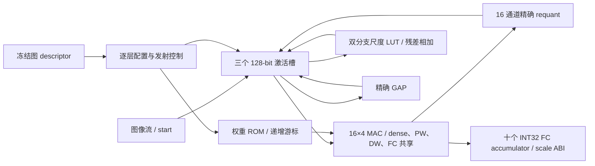
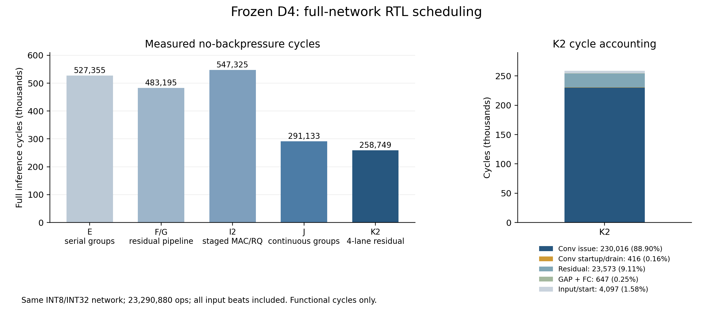

# D4 完整网络开发记录（2026-10-18）

## 最新状态

- G 已验收：实际32-bit接口，84次逐层exact、2次控制探针、3次连续推理；
  latency483195、start interval483197。网络、精度和计算账本保持冻结身份。
- E 已全top布线：21124LUT/4134FF/91BRAM/64DSP，WNS-5.590、WHS+.033ns；
  资源通过、125MHz setup失败。该物理结果与后续G分别列示。
- H 按选定的1:1补偿MMCM方案实现/验证中；E原生SAIF活动注入尚未完成。
- 各候选原始证据及失败原因见后面的迭代记录；原始目标继续保留。

## 基线审计与方向

起点为 `3dceefa`，工作树干净。D4 软件冻结清单的 13 个文件均经 SHA256
复核，retained candidate4 RTL/XDC 的 14 个文件也全部匹配。历史 C0 fullnet、
D4 standalone/OOC 的结果及边界仍有效，但本次没有重新执行历史物理实现。

优先补齐完整 D4 执行链。保留 204,090 参数、11,645,440 semantic MAC、
23,290,880 ops 与原有 INT8/INT32 语义，不启动训练或修改网络。
新建独立 `d4_fullnet_top`，不替换 C0，也不改写 retained v6。

选定结构：16 个输出通道 × 4 个输入通道的共享乘法数据面；同步片内权重 ROM；
128-bit NHWC 激活字；三个激活槽分别容纳工作张量和残差；逐层 descriptor
调度 dense 3x3、PW、DW、残差、GAP、FC。首版使用明确的读/乘/累加阶段，
先建立完整逐层 exact 证据，随后以实际周期和物理路径指导重叠与流水化。

残差缩放使用冻结浮点比值在全部 256 个 INT8 输入上的精确查表，避免近似
定点系数改变原 evaluator 的舍入。FC 输出 INT32 accumulator，配套保留
`head_scale * fc.weight_scale[channel]` 的反量化 ABI；它不是统一量化的 INT8
logit，不能直接对 raw accumulator 求 argmax。

完整推理从 accepted start 开始，包含之后的图像输入传输、全部层与最终十个
logit 的接受；权重属于预先驻留的固定网络 ROM。须另列配置/冷启动条件。
当前输入采用 ready/valid 流；尚无外部按请求延迟返回的 memory adapter，
因此输入停顿测试不能称为原合同的 response-2/response-64 验证。

## 评价与后续门

1. 新导出器审计源哈希、账本、全部算子和逐层 golden taps。
2. RTL 对真实图像逐层比较，检查全部 FC accumulator、复用、输入和输出停顿。
3. 同源 XC7Z020 full-top 8 ns 综合、route、setup/hold、资源和活动率功耗。
4. 根据证据优化，再评估架构或网络调整；改变网络时重新建立 accuracy 与账本。

125 MHz、当前 D4 运算量下，20 GOPS/W 要求 `start_interval_cycles * power_W <= 145568`。
2M cycles 只是时延上限，不能替代能效门。最终需要 accuracy、latency、energy
和硬件结构的可解释取舍；指标修改必须与原目标并列，不能用口径调整制造通过。

## 对历史路线的判断

C0 从早期完整系统、BRAM 流式缓存发展到 shared64，具备 CPU/firmware 与
完整仿真基础；较新的 D4 则解决了精度问题，但 v3--v6 主要围绕单个 block
优化，完整系统证据没有同步补齐。v5 的低周期伴随约 264k LUT，说明单独
降低仿真周期并不能推动部署。旧 v5 全网 projection 中还使用了 13-block
边界假设，而冻结 D4 模型实际为 10 个 MBConv；本次不继承该预测值。

D4 中 PW 占 87.79% semantic MAC，DW 占 8.39%，dense stem 占 3.80%。
下一阶段优先级是同步存储的供数率、PW 发射利用率、requant 服务与控制成本。
先通过逐层周期分解确认开销，再考虑加宽或共享计算单元。软件 C1/ResNet20
可继续作为质量参照，但现有局部 dense primitive 不构成 C1 完整硬件对照。

最终研究比较应保留 D4 精度基线和原始目标，同时报告 accuracy、每次推理
能量、延迟与资源 Pareto。若网络修改有必要，应通过同一训练/量化评估协议
和结构消融证明收益，不能单纯增加运算量来提高 GOPS/W。

## A 首版功能基线（历史记录）

新结构的首个完整网络 RTL 基线已通过；物理结果仍在验证。原 D4 的 91.46%
来自冻结软件结果的哈希复核，不表示新 RTL 已经通过 official test10k。

本次已重跑 retained 的六项回归，全部 PASS：DW adapter 26/26 请求/响应、
DW tile 3 cases、no-BP 24,039 cycles、random 25,389、final stall 25,421、
two-epoch 25,389/25,389。日志位于 `build/reports/d4_fullnet_20261018/baseline_*.log`。
新 top 在真实 CIFAR-10 测试索引 `0,1,3,4,6,11,12,13,22,25`（每类一张）
通过 3 模式 × 2 次启动，共 60 次完整推理。每次逐字检查 24,336 个中间
128-bit 字、全部 10 个 raw INT32 FC accumulator、41 个算子提交数和
11,645,440 MAC，未发现差异。模式包括无停顿、LFSR 伪随机输入/输出停顿、
连续 64-cycle 输入停顿与末尾 logit 停顿；done 保持及重复启动也通过。

无停顿周期为 **920,269**；伪随机首图为 920,629/920,617；长停顿首图
922,437/922,365。周期从 start 接受到 done 出现，包含最终 logit 接受，
不包含消费者故意延迟 done 握手的额外时间。100 MHz 下为 9.20269 ms；
125 MHz 下算术换算为 7.362152 ms，后者仍需要实际 timing closure 支持。

| 项目 | cycles |
| --- | ---: |
| 图像传输 | 1,024 |
| dense stem | 33,794 |
| PW | 560,682 |
| DW | 223,892 |
| 残差 | 100,110 |
| GAP | 562 |
| FC | 205 |
| 总计 | 920,269 |

日志和同源清单：`build/reports/d4_fullnet_20261018/`；向量与 exporter 验证：
`build/reports/d4_fullnet_vectors_20261018/`。首版接口修正是残差 LUT 的
`raw_byte XOR 0x80` 地址映射；修正后执行了上述完整回归。后续 exporter
review 发现仅 JSON logit 反量化使用了额外 FP32 scale-product 舍入，正在
修正为冻结 head scale 与原始 FC weight scale 的 FP64 重建；raw accumulator
与所有 `.mem` 内容不受该元数据修正影响。

按首版周期，125 MHz 下 20 GOPS/W 要求总功耗不超过约 0.158 W，能效尚未
证明。下一候选先提高读/乘/累加发射率和残差 LUT 服务率，保持所有整数语义。

## 迭代记录

### A：串行完整基线，功能通过、物理筛选负结果

完整 functional 源码与日志保存在
`build/reports/d4_fullnet_functional_baseline_20261018/`。
Vivado 2025.2 综合快照位于
`build/reports/d4_fullnet_synth_baseline_priv_20261018/sources/`。
综合为 19,542 LUT、3,375 FF、123 RAMB36、73 DSP；WNS/TNS
`-12.277/-23979.367 ns`，WHS/THS `-1.021/-430.921 ns`。
BRAM 超过 70%，最差 setup 是 op_index 到 weight RAM 地址的多级 DSP 乘法。
此候选未运行 route/power，不能用于物理达标或能效结论。

### B：每拍发射的中间诊断

将读、乘、累加重叠后观测到 502,863 cycles，十类别 60 次推理通过。
该版本仅用于周期诊断，已被下面带明确物理快照的 C 版取代；不签署 B 的 PPA。

### C：注册配置、权重游标与明确双端口 RAM

每层锁存配置，权重地址按实际发射递增，下一输出通道组继续游标、下一像素
回到本层权重基址；消除每拍的 descriptor 乘法地址链。特征存储的读写共用
同一端口地址 mux；仅在真正读取时使能 RAM，残差身份读使用另一端口。
未输出有效 logit 时物理输出总线置零，避免无效数据翻转。

C 版通过十类别 × 3 模式 × 2 次启动，共 60 次逐层 exact 推理；
no-BP **502,904 cycles**，伪随机首图 503,265/503,232，长停顿首图
505,046/504,974。相对 A 减少约 45.35%。新增逐层配置阶段每层多 1 cycle，
总计 41 cycles，包含在最终计数中。100 MHz 为 5.02904 ms；125 MHz 的
4.023232 ms 仍为待物理验证的频率换算。

功能日志 `build/reports/d4_fullnet_cursor_20261018/`；综合快照
`build/reports/d4_fullnet_synth_cursor_20261018/sources/`。综合完成：26,479 LUT、
3,441 FF、91 RAMB36、64 DSP，均低于 70%；WNS/TNS `-4.566/-9315.617 ns`，
WHS/THS `-1.021/-619.468 ns`。最差整体路径为 logit 组合 mux 到输出；
单独检查内部路径后，特征 RAM 地址仍有 `-3.618 ns` setup slack。
这些均为综合估计；未运行 C 的 route 或 power。
波形采集入口为 `scripts/run_d4_fullnet_activity_trace.sh`，生成真实 sample0
的一次完整推理 VCD；活动率转换和 post-route power 注入尚待集成验证。
导出器的 FP64 logit 元数据修正已通过 100 个 logit 精确比较，原 100 个
`.mem` 文件 hash 不变。

### D：注册输出与按边界拼接的地址

FC accumulator 捕获到十项队列，输出 payload/index/valid 使用保持寄存器，
接受一个 logit 才移动队列；去除输出前的 16:1 动态选择器。所有激活槽均为
2048 words、通道组为 2 的幂，按不重叠位域拼接 slot/spatial/group，消除
不必要的全宽加法进位链；越界 halo 仍读取安全地址并按原语义补零。

D 版真实十类别 60 次和 centered-zero、INT8 -128、INT8 +127、棋盘格各
6 次，共 **84 次完整推理逐层 exact**。无停顿 **502,905 cycles**，保留全部
11,645,440 MAC。相对 C 只多 FC 队列装载一拍。综合快照在
`build/reports/d4_fullnet_synth_regout_20261018/sources/`，物理结果进行中。
真实图日志在 `build/reports/d4_fullnet_regout_20261018/`，边界输入详细日志在
`build/reports/d4_fullnet_regout_edges_20261018/`。未改动网络、权重或精度。

### D 的物理负结果

D 综合为 26,309 LUT、3,770 FF、91 BRAM、64 DSP，WNS -3.205 ns。
随后 place 因旧 128-bit 外部输入导致 176 I/O 超过 CLG400 的 125 PL I/O 而失败
（`Place 30-58` / `Place 30-99`），没有 routed DCP，不能签署时序或功耗。
失败日志保存在 `build/reports/d4_fullnet_route_regout_20261018/`。

### E：仿射激活地址游标与可放置接口

在 INIT/ADDR_INIT 预备地址，tap/pixel/row 用固定 stride 递增；不再每拍重算
完整二维坐标乘加。物理 top 将四拍 little-endian 32-bit 输入拼成内部 128-bit，
将全部 4,096 拍输入计入推理；没有以 simulator-only 端口代替真实输入。

实际 physical top 已通过十真实样本与四边界样本 × 三模式 × 两次启动，共
**84 次完整逐层 exact 推理**。no-BP latency **527,355 cycles**，连续三次推理
两次启动间隔均为 **527,357 cycles**。核心 128-bit 接口的 524,282 cycles 仅作
诊断，不用于物理 top 的性能或能效。每次仍执行 11,645,440 semantic MAC。

| E 实际接口阶段 | cycles |
| --- | ---: |
| 图像传输与启动边界 | 4,097 |
| dense stem | 18,435 |
| PW | 281,919 |
| DW | 122,142 |
| 残差 | 100,117 |
| GAP | 563 |
| FC | 82 |
| 合计 | 527,355 |

功能、逐算子周期和完整 physical-top VCD：
`build/reports/d4_fullnet_affine_packed_20261018/`。
实现采用运行开始时固定的 RTL/ROM/XDC 快照：
`build/reports/d4_fullnet_route_affine_packed_20261018/sources/`。
父级核对全部 16 项 source manifest 与当前源码相符。当前物理结果仍待完成。
实际频率下 latency = 527355/f、吞吐 = f/527357、GOPS/W =
23290880*f/(527357*P_total*1e9)。125 MHz 仅是目标，不能在时序未闭合前称为
已验证工作频率；该目标频率下 20 GOPS/W 对应总片上功耗上限约 0.276 W。

平均计算率约 22.1 MAC/cycle，而数据面峰值为 64 MAC/cycle。残差服务、DW
并行度与量化/地址准备是优先研究方向；下一次结构选择应结合真实 routed
critical paths 与活动功耗，不通过提高运算计数或改变精度提高能效数字。

### F：残差逐拍 LUT 流水线，功能门通过

两路残差分支仍分别查完整 INT8 域的 round-away LUT，返回的 lane index 与
LUT 数据一起传递；ADD_ADDR 连续发射 16 个 lane，ADD_USE 排空最后一个。
网络、ROM、精度与全部 11,645,440 MAC 均不变。14 输入 × 三模式 × 两次
启动共 84 次完整逐层 exact 通过，另三次紧接推理验证连续启动间隔。

F no-BP **483,195 cycles**，start interval **483,197 cycles**，相对 E 减少
44,160 cycles（8.37%）；七个残差操作合计从 100,117 降为 55,957 cycles。
功能源快照：`build/reports/d4_fullnet_functional_residual_pipe_20261018/`；
日志和哈希：`build/reports/d4_fullnet_residual_pipe_20261018/evidence_summary.json`。
F 未独立综合，不能继承 E 的资源、时序或功耗结果。

E 综合已完成：20,566 LUT、4,006 FF、91 BRAM、64 DSP、80 IOB；
WNS -2.892 ns，最差为状态译码到 input_ready 的输出路径；仍在进行 P&R。
G 候选正在固定 F 基础上注册外部控制输出，要求不改变握手和计算语义，
并增加部分图像中途 reset 与额外输入探针；G 尚未通过前不报告其结果。

### E post-route：资源通过，125 MHz setup 负结果

2026-10-18 完成 XC7Z020 CLG400-1 全 top 布线，26,694 fully routed nets、
0 routing errors。实际为 **21,124 LUT（39.71%）、4,134 FF（3.89%）、91 BRAM
（65.00%）、64 DSP（29.09%）**，资源均低于 70%。8 ns 下 **WNS -5.590 ns、
TNS -28,192.908 ns；WHS +0.033 ns、THS 0**，setup 未通过。

最差路径为状态译码到 input_ready：输入时钟 IBUF/BUFG/全局网络的 launch
insertion 5.759 ns，数据路径 6.596 ns，输出 delay 1 ns；相对外部输入
clock 的约束还包含 0.235 ns uncertainty。该路径不能只通过内部运算 retiming
解决。G 正在去除外部控制译码；后续还需评估真实 MMCM 补偿时钟结构。

E 的现有 I/O 约束是原型共享时钟假设，output min +0.2 ns 不等价于外部
receiver hold +0.2 ns。没有板级接收器/走线规格，不能把该 WHS 称为板级
hold 验证。下一物理候选将明确 receiver setup 1 ns/hold 0.2 ns 的保守假设，
采用 output max 1 ns/min -0.2 ns；保留输入 min +0.2/max 1 ns 与 uncertainty。
这是收紧接口 hold 假设，旧 E 数字仍保留原始约束身份。

vectorless estimated total on-chip power 为 0.559 W（dynamic 0.440、static
0.118，Low confidence），只能作筛选。更完整的物理 top trace 已捕获一次
完整推理，4218944000 ps、278 个 VCD 变量、8340 SAIF bit entries，含全部
MAC product 寄存器；100% known residency 仅属该 VCD 范围，不是物理注入覆盖。
E 尚未在125 MHz 工作，不能将名义吞吐与该功耗组合成已验证能效。

### 下一候选的时钟方案（选定，尚未实现签署）

保留 125 MHz 共享时钟接口，采用 IBUF -> MMCME2_BASE.CLKIN1；反馈为
CLKFBOUT -> BUFG -> CLKFBIN，用户 CLKOUT0 -> BUFG -> 核心/接口寄存器。
输入 8 ns、DIVCLK_DIVIDE=1、CLKFBOUT_MULT_F=8、CLKOUT0_DIVIDE_F=8，
VCO 为1000 MHz；两路相位0，默认补偿模式。已从安装的 UNISIM 源确认 BASE
没有 COMPENSATION 参数，内部 ADV 默认 ZHOLD，不能向 BASE 传此参数。

物理输入仍是唯一 primary clock，MMCM 输出由 Vivado 自动推导；显式核实
生成时钟的1:1关系与0.2ns uncertainty覆盖，不能以独立时钟或异步分组放宽
数据路径。MMCM reset 仅来自外部 reset；下游 reset 由 !reset/!LOCKED 异步
置位、在内部时钟同步释放，ready/valid/done 在初始化与失锁期间必须无效。
失锁是 abort/reset，需要上游等待 readiness 后重传，不能声称不停顿继续。

通用 Verilator 的1:1时钟/延迟lock模型只验证相同数据面和握手逻辑；还需要
真实 UNISIM 原语 startup/reset/relock 仿真与综合后 MMCM/BUFG 实例检查。
该方案不保证内部数据路径闭合，仍须完整 post-route setup/hold、输入输出
路径和 reset recovery/removal 验证；没有板级振荡器/走线规格或上板结论。

### G：外部控制注册，功能与协议验证通过

start_ready/input_ready/done_valid/busy 在状态转换时更新，32-bit packer 用
输入计数明确关闭第4096个beat之后的ready，不再用核心状态组合译码直接驱动
输入ready。保持 F 的残差流水，核心 arithmetic/scheduling 不变。

父级验收42个sample/mode日志、84个逐层exact记录、2次包含部分图像reset、
held-start与额外输入探针的完整推理，以及三次连续启动；latency483195、
interval483197均不变。源文件写入早于最终可执行文件构建和后续回归。
证据：`build/reports/d4_fullnet_regcontrol_20261018/evidence_summary.json`；
源码快照：`build/reports/d4_fullnet_functional_regcontrol_20261018/`。
G没有独立PPA，不能继承E数字。H已按上述选定的MMCM方案开始实现/验证。

### H / I：补偿时钟与运算流水线的验证边界

H 的通用模型通过完整回归和协议探针，真实 UNISIM 原语测试也通过启动、
外部 reset 与失锁复位检查。输入时钟恢复后仍需外部 reset 才能重新锁定，
不声称自动恢复。最终时钟 RTL 随 I 再次通过完整数据面回归。

I 将 BRAM 返回数据、乘法操作数、乘积、四项平衡加法树及 accumulator 分级，
量化系数在组初始化时锁存，量化乘法前另行捕获 accumulator；halo 在已注册的
操作数处归零，避免驱动 BRAM 地址 mux。网络、精度和 semantic MAC 不变。
14 输入 × 3 模式 × 2 epochs 的 84 次逐层 exact、2 次协议探针与3次紧接推理
通过，latency **547,325 cycles**、start interval **547,327 cycles**。

I 的 immutable 综合源位于
`build/reports/d4_fullnet_synth_staged_quant_mac_v2_20261018/sources/`；
其17项 manifest 与功能验证源核对通过。综合为19,320 LUT、5,523 FF、91 BRAM、
64 DSP、1 MMCM、2 BUFG，**WNS -3.112 ns**，尚未布线。最差量化路径从
rq_product 到 rq_value，10.742 ns、35个 CARRY4；原 abs/舍入/恢复符号引入
串行进位链。综合时钟报告确认8 ns physical primary及1:1 MMCM generated clocks，
setup/hold uncertainty均0.2 ns。不能将综合结果称为 post-route 达标。

### I2：精确偏置舍入，完整验证进行中

用 signed 65-bit `x + 2^(shift-1) - (x<0)` 后算术右移，替代 abs/舍入/恢复
符号；shift=0时偏置为0。多一位防止shift=63时正数加偏置溢出，保持负数
tie-away语义。乘法符号在量化乘法阶段同步捕获用于偏置，GAP采用相同等价式。
独立 RTL 单位测试覆盖边界与随机乘积/64-bit输入、全部64种shift，
**1,292,544 cases PASS**。完整84次逐层exact、2次协议探针、3次连续推理也通过，
latency547,325、启动间隔547,327 cycles。证据及源码快照：
`build/reports/d4_fullnet_biased_round_20261018/`。

I2综合为 **16,121 LUT、5,641 FF、91 BRAM、64 DSP、1 MMCM、2 BUFG**，
WNS **-1.616 ns**、synth WHS -0.155 ns，仍未达时序目标，尚未布线。
综合与功能冻结源的3个RTL和XDC四项哈希相符。整体最差路径为
rst_n经operational组合掩码到status输出；内部最差为残差LUT BRAM到加法/饱和
再到result_vector，WNS -1.083 ns。量化长进位链已不在内部前20条最差路径。
物理输入、反馈及core时钟均8 ns，generated clocks保持1:1与0.2 ns uncertainty。
综合目录：`build/reports/d4_fullnet_synth_biased_round_20261018/`。

后续连续组调度的静态下界分析记录于
`build/reports/d4_fullnet_continuous_group_bound_20261018.json`：21,377个输出组，
230,080个真实读/乘发射周期，每组K至少4；CONV源槽与目标槽均不同。
当前组间排空/重启开销是下一架构研究重点。约291k cycles仅是分析下界，
不是已实现性能；选择实施前仍需检查 accumulator 生命周期、量化metadata与双端口
存储调度，并保持完整逐层exact验收。

### 下一架构 J 的评价方法

root已选定双16×32 accumulator bank连续输出组调度，由独立执行owner实现，
尚未验收。MAC阵列仍16输出×4输入；CONV读源槽与写目标槽使用BRAM两个端口，
量化/写回与后续组的MAC重叠，全部结果带各自地址和系数metadata。
除了原84+2+3回归，还要求在CONV/RQ有在途数据时reset，再重启完整exact推理。

I2平均约21.28 semantic MAC/cycle，是64 MAC/cycle峰值的33.25%。
冻结图的230,080个发射周期同时包含DW较低并行度，不应把所有层都按64MAC/cycle
反推理想性能。J的≤300k目标主要消除可观察到的组间气泡，不削减网络运算。
即使达到300k，在名义125MHz下，20GOPS/W仍要求总片上功耗≤0.485227W。
该数字仅是原目标的代数边界；实际能效必须等待J同源post-route时序、真实启动
间隔与活动功耗，不能继承E或I2的数字。

### J：连续双bank功能验收通过

J实现上述固定结构，14输入×3mode×2epoch的84次逐层exact通过，另有既有2次
协议探针、3次紧接推理以及1次MAC/RQ同时在途reset后重启完整exact通过。
**no-BP latency291,133 cycles、start interval291,135 cycles**，相对I2降低46.81%。
随机停顿模式292,478–292,487 cycles；周期停顿/末logit停顿模式299,140–299,202。
全部MAC及中间字账本保持原值，没有修改网络、权重或舍入精度。

root核对5个源码/快照哈希、42个sample/mode日志和84条exact记录，并审查K=4时
bank捕获/重用同拍的非阻塞赋值顺序、输出metadata和最后store排空边界。
功能验收记录：`build/reports/d4_fullnet_continuous_groups_20261018/parent_acceptance.json`；
生命周期时序表、源码清单及reset探针证据在同目录。默认回归未放宽。
该候选尚无综合/布线/功耗结果；优先综合J，I2保留synth-only对照，不重复I2布线。

残差后续候选仅做静态预筛：冻结3,584项完整LUT值域为[-142,141]，9-bit signed可
无损表示，两路和需10-bit。原32-bit表、所有分支独立舍入结果与模型INT8/INT32身份
必须保留；若采用无损存储/加法结构，须证明全表与全部可达地址的精确性。
`build/reports/d4_residual_lut_exact_width_screen_20261018.json`记录源哈希；尚未改RTL。

### K：四lane残差流水与同步器状态限定，功能/原语门通过

K使用四份双端口9-bit残差ROM，每周期处理四个lane，分别寄存查表返回、10-bit
两分支和、INT8饱和结果。每个原32-bit表项的signed9 sign-extension均与原值
一致；全部七个ADD基址及其256个偏移有效，458,752个分支输入对与独立32-bit
加法/饱和参考一致。因此是无损表示和并行调度，网络INT8/INT32、各分支先舍入
再相加的语义均未改变。证明脚本为`tests/verify_d4_residual_exact_width.py`。

operational改为已有reset_release_sync最后一级Q，即core_reset_n。该同步器仍
由外部reset或失锁异步清零、两级同步释放；去掉原始reset/LOCKED到外部状态
掩码的重复组合旁路，不改变MMCM、外部接口时序约束或握手周期。
真实UNISIM启动、外部reset重锁、停钟失锁及恢复重锁检查通过。旧测试日志
`period_ns=8000`使用`%t`按ps显示，实际断言检查的是8ns，不能按标签解释为8000ns。

全14输入×3mode×2epoch共84次exact、2次控制探针、3次连续推理和在途reset后
完整重启均通过。**latency258,749 cycles、start interval258,751 cycles**；
随机停顿260,091–260,110、周期停顿266,804–266,839 cycles。较J再省32,384 cycles，
七个残差操作合计从55,957降至23,573 cycles。全部MAC/中间字/FC账本保持原值。
root核对206项manifest、当前核心/时钟/封装/XDC/TB与冻结源、42份日志/84条exact。
证据：`build/reports/d4_fullnet_parallel_residual_20261018/`。

BRAM数量仍需实际综合验证，不能以ROM形状估算宣称资源通过。已启动K的冻结源
SynthOnly：`build/reports/d4_fullnet_synth_parallel_residual_20261018/`。
J仅准备源码未运行综合；I2保留综合负结果。K尚无post-route/功耗结论。

K该轮综合出现Synth8-2914/8-5743：继承自J的features双写端口模板不受支持，
工具尝试回退LUTRAM。root在时序优化前停止该轮，保留sources/log，不能使用其
资源或时序数字。J/K功能exact不代表BRAM推断成立。原J执行owner按固定最小假设
修正两端口单地址mux及规范同步READ_FIRST模板，保持组调度和K残差不变；
短RAM推断probe与修正后的完整回归进行中，之后须重新全网综合。

修正后的K2已通过完整84次exact、2次控制探针、3次连续推理和在途reset重启，
latency/interval保持258,749/258,751；5项源码与快照hash一致。独立probe映射32个
RAMB36E1且两个端口均READ_FIRST。当前只确认模板可推断与全网数值/协议正确，
全网资源/时序仍待新run。修复差异与父级验收：
`build/reports/d4_fullnet_ram_ports_20261018/parent_acceptance.json`。

新增保守INT32安全界证明读取全部冻结weight/bias及41个descriptor，按每个
输入均可独立取[-128,127]计算每输出通道累加器区间，含bias且覆盖部分和。
全局界为[-43,658,799,1,213,954]，最多27个signed位，保留INT32运算不会溢出。
图的semantic MAC总数仍核对为11,645,440。入口：
`tests/verify_d4_accumulator_bounds.py`；结果：
`build/reports/d4_accumulator_bounds_20261018.json`。没有据此缩窄RTL accumulator。

### K2：完整综合资源通过，准备post-route签署

上图直接读取各阶段sample_0 no-BP通过日志，保留日志SHA256与SVG/JSON，
不混入时序或功耗。K2的32个CONV均为`issue_cycles + 13`，
230,016 + 32×13 + 23,573（ADD）+ 647（GAP/FC）+ 4,097（输入/start）
= 258,749 cycles。`build/reports/d4_k2_cycle_accounting_20261018.json`记录逐层核对。
发射周期占88.90%不等于全部64 MAC均满载；DW并行度、stem输入尾部等仍使
按真实semantic MAC和完整周期计算的阵列峰值利用率约70.3%。

K2全网综合完成：**20,377 LUT、11,173 FF、93 BRAM（66.43%）、64 DSP**，
1 MMCM、2 BUFG。features32、weights57、residual4，全部RAMB36E1，RAMB18为0。
三份RTL与功能快照hash一致；资源综合门通过。WNS **-0.504 ns**、TNS -372.150，
synth WHS -0.172 ns；内部最差 **-0.219 ns**。整体最差为logit_ready到state CE，
内部最差为rq_bank_input到RQ DSP PCIN。仍是综合负时序结果，完整route已选定。

后端预检发现原XDC的set_input_jitter参数次序错误，原0.05ns命令被忽略。
root按本机Vivado官方man修正为`set_input_jitter [get_clocks physical_clk] 0.050`；
该命令官方说明在synthesis阶段忽略，因此保留已完成综合netlist，在route载入后
显式施加此唯一更正并检查INPUT_JITTER属性。0.2ns uncertainty、I/O delays与
8ns时钟关系保留，不重建primary或重置时序。旧源及旧warning保留，route另存
更正约束与overlay哈希。不得把原synth报告称为已施加0.05ns抖动的物理签署。

### E活动功耗工具的原生验证边界

正确语法SAIF的native3完成：816/45,672物理nets匹配，total0.540W、Low confidence；
覆盖不足且E未在125MHz闭合，不能签署运行能效。native4的逐点活动参数失败；
native5改用绝对signal_rate后仍逐点运行成本高，14.4分钟后经root授权停止。
终止时缓冲区刷新出3,582个partial assignments，无最终summary或power报告。
该次是运行时间负结果，不是零活动，也不是成功功耗结果。原始日志完整保留。
后续工具将用精确FD-Q物理网名构建别名SAIF、批量read_saif，保持T0/T1/TC原统计，
原RTL-SAIF与别名-SAIF覆盖分别报告；方法原生验证仍在进行。

native6已完成该原生工具验证（exit0，约2分58秒）：原SAIF匹配816/45,672，
精确FD-Q别名SAIF匹配4,137/45,672。两次导入的重叠未知，不相加为联合覆盖。
总片上估算0.546W（dynamic0.428W、static0.118W），overall confidence仍为Low；
I/O confidence为Low，报告称超过75%的输入缺少用户指定活动。summary早期将
79个顶层源统计候选写作已注入端口，该表述不构成物理注入证明。现已更正
规范化summary，历史raw报告保持原样；显式非时钟INPUT端口活动修正已通过
9项离线测试（0skip）与解析检查，原生验证另开native7，不能沿用native6签署。
E checkpoint的内部setup slack仍为-4.793ns，故native6只证明工具可运行与部分
活动映射，不能签署125MHz运行能效，更不能作为K2功耗。完整证据：
`build/reports/d4_activity_power_tooling_20261018/native_attempt_6_fd_q_alias/`。

### 当前root验收与后续方向

K2完整route与只读checkpoint检查、E native7工具验证均已结束；L完整功能回归
窗口已释放。
K2的125MHz setup失败，尚无活动功耗或运行能效达标结论。最终验收契约见
`build/reports/d4_k2_final_evidence_contract_20261018.md`，明确同源checkpoint、
约束、数值/协议回归、波形来源、活动覆盖与吞吐能量口径。

结构上，K2每卷积只剩13cycles排空开销；下一轮已依据实际路径选择RQ流水与
完成握手状态边界。显式三槽存储可能减少平坦
数组深度取整损耗，但目前仅为候选方向，尚无实现/PPA证据。详细网络条件、
数据流、无损表示证明和资源/能效边界见`docs/d4_fullnet_architecture.md`。

### K2完整post-route：资源与hold通过，setup负结果

固定Explore候选完成，全32,072条可布线网络已路由，0 routing errors。
LUT20,214（38.00%）、FF11,155（10.48%）、BRAM93（66.43%）、DSP64（29.09%）；
**WNS-0.990ns、TNS-950.034ns、WHS+0.005ns、THS0**。vectorless估算总片上
0.505W、Low confidence，仅作未闭合设计的诊断值，不计算已验证工作能效。

最差内部路径为state_reg[4]_rep__7到rq_product_reg[2]/PCIN[0]，data7.196ns
（logic4.678、route2.518）。最差外部路径为done_ready到state CE，-0.663ns，
data5.829ns（logic1.942、route3.886）。因此不单靠改route策略继续尝试同一RTL。
报告目录为`build/reports/d4_fullnet_route_ram_ports_20261018/`；root核对最终17项
source哈希、与功能快照一致的3份RTL，以及唯一XDC jitter更正overlay。

只读重开checkpoint确认physical/generated8ns、1MMCM/2BUFG、INPUT_JITTER0.050ns、
uncertainty0.200ns。check_timing常规缺约束项为0，但时序报告另列87个max/87个min
异步复位相关未定时端点，示例为MMCM LOCKED到reset同步器CLR，不能将infinite
slack称为恢复/移除通过。两级复位同步FF均ASYNC_REG=1、SHREG_EXTRACT=NO，
同处SLICE_X113Y76；异步断言、同步释放边界及无全局CDC/亚稳态测量的限制保留。

### L候选：精确部分积流水与完成token，功能开发中

root按上述两类失败路径选定：CONV的signed32×signed32使用四个窄部分积寄存，
再寄存cross/base合并及最终64-bit和；保持16lane、完整64-bit product和65-bit
舍入语义，metadata逐级同行。完成token由既有done_valid独立保留，完成后主
计算状态返回IDLE；start_ready在真实完成握手后才抬高，IDLE只接受真实start
握手，从而切断done_ready直接控制主state的路径。两个结构变化属于同一L候选，
不能把未来PPA收益全归于RQ单独改动。

执行owner指出旧RQ_CAPTURE/RQ_MULT/RQ_ROUND/RQ_CLAMP没有任何状态入口；GAP实际
使用固定round_shift(...,4)。root修正了最初将其误称为GAP乘法路径的契约，
明确不激活死状态、不改GAP；只允许在完整状态入口审计及K2快照保留后移除
这四个不可达旧分支与其独占寄存器。所有可达算子、输入/输出协议保持。

L要求至少百万次实际SV完整signed32乘积检查、原84次完整回归与控制/连续/reset
探针，并新增完成背压、持续start请求及pending完成时reset的验证。当前尚无
功能或PPA结论；执行契约位于`build/reports/d4_fullnet_rq_partial_pipeline_20261018/parent_contract.md`。

root同时补强未来活动trace的来源链：新implementation快照包含packed TB；
trace helper的D4_SOURCE_ROOT指定SV/TB，D4_WORKING_ROOT指定ROM/input/golden运行
目录，编译输出和日志仍位于repo build树。全部运行时.mem在仿真前后核对hash。
脚本已通过bash语法、PowerShell wrapper AST以及从repo外调用的路径/运行目录
fixture验证；该fixture使用模拟编译/仿真命令，**没有运行真实RTL或生成VCD**。
证据：`build/reports/d4_trace_snapshot_probe_20261018/result.json`。真实活动trace
仍等待功能通过且时序闭合的最终候选，不为失败K2另跑大波形。

### E native7：真实输入端口活动注入原生通过

native7使用已修复SAIF和原E routed DCP，未重新转换VCD、未重跑P&R；Vivado
exit0、无重试。80个顶层port统计均精确匹配：38个IN中排除1个clock，其余
37个按原T0/T1/TC实际设置；42个OUT不设置。root独立核对37项输入方向、clock
排除、已知态时长与signal_rate/static_probability公式，并验证37项报告hash。
证据：`build/reports/d4_activity_power_tooling_20261018/parent_native7_acceptance.json`。

I/O activity confidence从Low升为High，overall由Low升为Medium，内部仍为Medium
（少于25%内部节点用户指定）。原SAIF816/45,672与FD-Q别名4,137/45,672分别保留，
重叠未知，不相加。估算total0.546W、dynamic0.428W、static0.118W；数值与native6
一致不意味着原端口注入已成立，而是本轮获得了原生设置与confidence证据。
E的setup仍失败，故只能接受工具包，不能签署E运行能效或把该功耗转用于K2/L。

### L2：有效位使能功能门通过，冻结综合

RQ lane四级数据寄存器分别使用in_valid/common_valid/partial_valid/merge_valid使能；valid每拍推进，复位清零，算术和latency不变。父级核对148项manifest（140个冻结向量）、42份双epoch日志、RTL差分和额外控制/复位/连续推理日志，接受84次逐层exact、1,000,256次乘法检查及300,077个valid gap；归档实际回归binary和verFiles。latency258,813、启动间隔258,815 cycles，单测1条及packed构建114条warning如实保留。

功能验收：`build/reports/d4_fullnet_rq_valid_enable_20261018/parent_acceptance.json`。综合使用18项冻结源/TB/向量/约束快照，路径`build/reports/d4_fullnet_synth_rq_valid_enable_20261018/`；尚不能引用任何L2物理、功耗或运行能效结论。

### L2完整综合：RQ改善，启动路径成为瓶颈

同源18项快照的Vivado SynthOnly exit0。18,739 LUT（35.22%）、9,653 FF（9.07%）、93 BRAM（66.43%）、64 DSP（29.09%）；feature32、weight57、residual4 BRAM保持。WNS -1.051ns/TNS -43.642ns、WHS -0.173ns/THS -42.437ns，仍是综合负setup/hold，不能推导工作频率。最差输入start_valid到state CE为6levels、data5.245ns；内部read_halo地址边界计算最差-0.100ns、data7.730ns。RQ round裕量+2.905ns，lane product报告+4.243ns；某些源级common/cross寄存器被吸收，未匹配组不作该级裕量声明。全部数字仅对应L2综合。

证据：`build/reports/d4_fullnet_synth_rq_valid_enable_20261018/parent_synthesis_acceptance.json`。本轮选择先切断外部启动组合路径，不直接P&R。Candidate M固定为wrapper单入口寄存启动token，外部握手入队、核心握手消费、pending时阻止重复接收；预计增加1cycle，保留外部accepted start计数起点并由完整协议/数值回归实测。核心网络与算术结构不动。契约：`build/reports/d4_fullnet_start_token_20261018/parent_contract.md`。

真实Verilator小fixture证明16个indexed generate scope及其rq_mul子scope，转换/Tcl parser统计保持（14,195 records）；14项离线tests通过。真实Vivado综合则给出16个`u_core/rq_mul_lanes[N].rq_mul`复合名字，ORIG_REF_NAME与PARENT均有证据。后续工具只允许这16项显式prefix绑定并在最终DCP重新验证，不允许通用slash/dot猜测；尚无新native活动覆盖结论。

L2真实运算利用率账本：descriptor独立重算32个CONV共11,642,880 MAC，FC为2,560 MAC，总计11,645,440，保持23,290,880 ops口径。卷积230,016发射cycles的平均为50.6177 MAC/cycle（64lane的79.09%）；全推理按258,815启动间隔为44.9952 MAC/cycle（70.31%）。125MHz下11.2488 GOPS仅为条件计算，仍需时序通过；20 GOPS/W对应每次推理能量上限1.164544mJ。证据：`build/reports/d4_l2_architecture_efficiency_20261018.json`。

### M完整功能通过，冻结综合启动

wrapper单pending_start寄存器切断外部start_valid直达核心输入；busy包括pending占用，前一事务sticky error在新token等待消费时被mask。首次完整attempt发现旧error可见性失败，失败日志保留；最终84/84 exact及pending-start reset、held-start和最初两拍输入、控制/error restart、RQ/MAC在途reset、pending-completion reset、3次tight门全部通过。外部accepted start仍为统计起点，core258,813与external258,814 cycles分开报告，interval258,816；TB明确核对external=core+1。

父级核对364个归档artifact哈希、140个原mem向量完全不变、4项当前RTL/TB与功能冻结源相同、42份双epoch日志及全部探针markers。总归档196个向量/元数据文件（含原140mem），构建120warnings如实保留。功能验收：`build/reports/d4_fullnet_start_token_20261018/parent_acceptance.json`。18项同源综合快照（含10个sample0 mem匹配）位于`build/reports/d4_fullnet_synth_start_token_20261018/`，Vivado已启动，尚无M的PPA结论。

### M综合完成，选择一次完整P&R

同源18项快照综合exit0：18,741 LUT（35.23%）、9,654 FF（9.07%）、93 BRAM（66.43%）、64 DSP（29.09%）。WNS -0.467ns、TNS -23.361ns、WHS -0.173ns、THS -42.185ns，仍未通过综合时序；最差输入换为logit_ready到state CE，内部halo仍-0.100ns，RQ round+2.905ns。对比L2只增加2LUT/1FF，启动边界改善但尚无post-route结论。父级已接受负结果并选定一次Explore完整P&R；契约`build/reports/d4_fullnet_route_start_token_20261018_contract/parent_contract.md`，执行owner`d4_m_route`。原8ns、.050ns jitter、.2ns uncertainty、IO delays与5pF负载全部保持，不新增宽泛时序例外。

### 显式RQ活动层级工具离线验收

16个有真实Vivado层级证据的composite instance采用显式prefix绑定，校验最终checkpoint的NAME/ORIG_REF_NAME/PARENT后才允许FD-Q alias。原统计、物理NET NAME、共享net冲突排除保持。父级检查四个源hash、两项raw artifact hash、16行mock验证及可移植fixture边界后接受离线工具门。25pytest（0skip）；真实Verilator小SAIF14,195 records、lane0/15 product[0]统计逐项保持，16项native属性仍由mock提供。早期手写SAIF证据和ignored build依赖已明确分离，常规pytest改为自包含小fixture。

验收：`build/reports/d4_activity_binding_20261018/parent_acceptance.json`。当前Tcl SHA dd56c38cb854f42ade322570bada61b16ebee7712b2dfa3b8f2562fb3dfc030d 尚无原生运行；native7 E验证的是旧helper，不能沿用为当前工具或M的native成功。最终route后仍需逐行native绑定、真实全网trace、同源post-route活动功耗与窗口吞吐核算。

M的输出ABI另行核对：14组归档FC .mem与expected_fc.json raw值一致，140个float64 logits按冻结head_scale×逐通道weight_scale重建与expected完全一致，argmax均匹配；证据`build/reports/d4_m_fc_output_abi_20261018.json`。这把RTL rawFC exact与模型logits关联起来；不代表重跑test10k或测量CPU/板级分类端到端延迟。现有FPGA周期从外部start到rawFC交付后的done，主机预处理/scale/classify不计为已测。

### M post-route初步负结果，N halo候选进入功能门

owner确认0routingerror，WNS -0.287ns/TNS -2.080ns（18setup失败端点）、WHS +0.006ns/THS0；资源百分比LUT34.20%、FF9.04%、BRAM66.43%、DSP29.09%。最差为ox_reg[0]到read_halo，9levels、logic3.946ns+route3.966ns。125MHz setup仍失败，不生成M全网trace。最终18端点类别、IO/async-reset精确范围与完整来源归档仍待owner交付；这些初步值不替代父级最终验收。

Root选择N：只用冻结几何等价边界判断替换halo坐标加减/比较，预期周期保持M258,814/258,816。原32CONV全部33,120坐标组合数学穷举相同（1,621halo），下一门必须检查实际修改RTL并覆盖FC，随后完整84+全部token/control/reset/tight。owner`d4_halo_edges`，契约`build/reports/d4_fullnet_halo_edges_20261018/parent_contract.md`。M只读DCP窗口已exit0并释放，N可用WSL jobs2完成验证；没有N的Vivado授权。

### M最终物理验收与N功能接受/O选择

M父级验收为NEGATIVE_RESULT（worker的DONE只表示检查结束，未代表125MHz通过）：18,197 LUT、9,620 FF、93 BRAM、64 DSP，27,200 routable nets全部完成、0error；WNS -0.287/TNS -2.080，WHS +0.006/THS0。18个失败端点分为halo3、logit_ready输入14（最差-.210）、busy输出1（-.023）。vectorless功耗0.378W（dynamic.263/static.115，Low confidence），不能签署工作能效。18项自包含源快照和DCP输入/输出/Tcl/manifest hash已核对；output DCP E8C1D4C8ECE07FB17D828485A618BDC90DF8783688372DF00372A4AD61DB114C。

异步控制端点148：同步后的core reset驱动146个CLR，外部rst_n和LOCKED分别到两级syncCLR；两级ASYNC_REG=1/SHREG_EXTRACT=NO、同X111Y76。LOCKED到同步CLR仍无限slack/无group，不算全部reset recovery/removal闭合。all_fanout的10,362是可达endpoint锥，不是直接CLR负载；全部148异步端点已有清单，额外非异步endpoint全名导出在Tcl前遇到Failed to install all user apps，未改变DCP且不再重试非必要项。验收见`build/reports/d4_fullnet_route_start_token_20261018/parent_route_acceptance.json`。

N只替换halo及其模拟几何guard，实际RTL33,120几何/1,621halo/FC通过，84与全部probes同M周期/每条PASS metric一致；parent核对329项hash、42双epoch日志、current core5ff3abb7a4a03de4051a3b7555326ebe475323c4aa25f404a3465deb170221d2并接受功能。geometry74/packed118 warnings如实保留。没有N综合/P&R。

独立IO负路径明确后，root选择O合并版本再综合：仅去掉wrapper logit_ready输入的operational AND。operational与core.rst_n同网，ready只在主同步reset优先块消费；active时旧新ready相等、reset时状态复位优先，预期无周期/协议变化。O须全84+所有原probes，并补ready高/翻转跨reset/unlock与live stalled FC reset后exact restart。不得改输出保护或其他结构，契约`build/reports/d4_fullnet_ready_reset_gate_20261018/parent_contract.md`。

### O功能验收与冻结综合

O父级核对454项artifact hash、196项向量hash、4项功能RTL/TB同源、单行wrapper差分和84条exact指标，接受功能门。所有原probe指标与N一致；新增私有probe在FC输出停顿3周期后reset，ready在reset/unlock中翻转（10个unlock边沿），随后完整golden restart。正常84回归保持原packed TB，全局TB未改。外部latency258,814、tight interval258,816 cycles不变，核心仍为N的5ff3abb7...。attempt1仅私有TB多13条非致命warning；修复TB声明后attempt2两次编译均118warnings，失败/早期日志均保留。

父级接受文件：`build/reports/d4_fullnet_ready_reset_gate_20261018/parent_acceptance.json`。冻结综合目录`build/reports/d4_fullnet_synth_ready_reset_gate_20261018`，18项快照及10个sample0 mem与功能输入hash一致，沿用8ns/.050ns jitter/.2ns uncertainty及原IO约束。综合正在执行，尚无O资源、时序或功耗结论；是否进行一次P&R由综合证据决定。

### O综合负结果与物理验证选择

冻结18项输入综合exit0，18,831 LUT（35.40%）、9,898 FF（9.30%）、93 BRAM（66.43%）、64 DSP（29.09%）；feature32/weight57/residual4 BRAM保持。WNS/TNS -1.017/-1.017ns，只有1个setup失败端点done_ready到start_ready CE，6levels、data5.211ns；WHS/THS -.157/-40.053ns。logit_ready输入+.216ns，内部最差+.632ns（accum到result_vector）。相较M综合，失败端点数和内部裕量有改善，总体最差WNS仍负，不能称125MHz通过。父级核对18项hash与DCP AE8AD3273A322B3A7903FABB12E5BD2589A5BE3059B8AE77C5F5900A83BCE824，接受synth-only负结果，并选定原约束下一次Explore P&R。物理owner d4_o_route，契约`build/reports/d4_fullnet_route_ready_reset_gate_20261018_contract/parent_contract.md`。不提前修改done_ready或busy结构，不给N单独跑P&R。

### 2026-10-19：O物理负结果接受，P控制网拓扑候选

O唯一Explore P&R完成，父级核对18项source、4项功能RTL/TB、输入/输出DCP、manifest、runner/Tcl hash及22个唯一setup失败端点后，接受NEGATIVE_RESULT。18,279 LUT（34.36%）、9,863 FF（9.27%）、93 BRAM（66.43%）、64 DSP（29.09%）；27,752 routable nets全部完成、0errors。WNS/TNS -.221/-2.352ns，WHS/THS +.049/0。ready输入到logit data/index CE18端点，logic1.819ns、route3.090..3.351ns，末级CE网扇出292；lane1 merge_valid到lane10 product CE4端点，logic.456/route6.757ns，扇出960。halo、busy、done_ready均不在负setup集合。vectorless.384W（dynamic.269/static.115，Low），不运行本候选大trace/活动功耗，不签能效。148 async控制pins，两级sync同slice且ASYNC_REG1/SHREG_EXTRACT NO；LOCKED到CLR仍infinite/no group，非完整reset timing closure。无boardLOC/bitstream声明。输出DCP F44CA12F8D0783364824828B9835E9B4FD0C464B8AA42A3CCC531D4C39B260DF。

P固定两处修改：FC_LOAD仍快照9个后续accumulator，FC_OUT不再逐次ready移位整个队列，改为用当前logit_index读取固定队列；另仅对每lane merge_valid FF加DONT_TOUCH TRUE，保持16个本地控制驱动。预期无算术/协议/周期变化，但必须84完整exact+原probes+O私有ready/reset探针后才运行一次冻结SynthOnly，并检查真实merge-valid保留和direct fanout。P最初启动即遇额度限制，没有执行；用户确认额度恢复后继续同一owner/契约，不算候选失败。契约`build/reports/d4_fullnet_fc_static_local_ce_20261018/parent_contract.md`；当前没有P验收结论。

### P完整功能与正setup综合接受（2026-10-19）

P仅两处预定core delta，84完整exact、原probes及O私有ready/reset探针通过；94条D4指标与O逐条一致，196项vectors/metadata相同，两种编译各118warnings且normalized headers同O。外部latency258,814/core258,813/tight interval258,816 cycles不变。父级核对414项artifact hash（manifest12E17DF63CB46516F3D3333FC9014D1E34282BC5CF0EFA097F1E7E917C8A6D26）、18项快照、4功能RTL/TB与10sample0mem，17项综合输入同O，唯一变动core SHA D438BC8855D2999307BED61B044C3B4FB716E5F17E53AFBE5BA830BEC323083E。

一次SynthOnly exit0，18,327 LUT/8,900 FF/93 BRAM/64 DSP；WNS+.106ns/TNS0/0setup失败，WHS-.155ns/THS-34.821/1102hold失败。内部+.473ns，最差输入logit_ready到state CE+.106ns。相较O综合减少504LUT/998FF；这是该次工具结果，不能只归因于某一处RTL改动。只读DCP真实保留16个DONT_TOUCH merge_valid FDRE，每路Q直接驱动本lane64个product CE（总1024）；FC队列独立CE288，输出CE40，与O共享CE292不同。宽泛merge_valid文字匹配19对象包含2LUT和1core FF，实际目标16lane FF均通过，未把非目标计为失败。

父级接受功能与综合拓扑，综合负hold仍如实保留，选择一次原约束Explore完整P&R。输入DCP D529F79A0662FD7B374A85F4925A3F1AB926450A3FB775F34D6C476E06E3A259；owner d4_p_route，契约`build/reports/d4_fullnet_route_fc_static_local_ce_20261018_contract/parent_contract.md`。尚无P post-route、活动功耗、能效或板级结论。

### P首次同步125MHz完整物理通过（2026-10-19）

P唯一Explore物理运行exit0，25,587/25,587网全部布线、0routingerrors。WNS/TNS +.128/0，WHS/THS +.010/0，setup/hold失败均0。输入最差+.301ns（ready到data CE），输出+.151ns（start_ready），内部+.128ns（weight_cursor到weight RAM地址）；原ready、merge_valid违例已消除，ready路径仍真实存在。17,239 LUT（32.40%）、8,864 FF（8.33%）、93 BRAM（66.43%）、64 DSP（29.09%）。真实routed拓扑16个本地DONT_TOUCH merge-valid各驱动64product CE，FCqueue独立CE288/outputCE40保持。父级核对18source、4功能RTL/TB、10mem、DCP/Tcl/runner/manifest hash后接受同步125MHz门。输出DCP 2D145331DCA7D8A12A399F45BEC746CEE6DCB147E1577BF551770A7F4A1AE1E6。

Vectorless.383W（dynamic.268/static.115，Low）仅筛选。DRC含80个未绑定LOC端口、REQP-1839 RAMB异步控制warning（报告在20条处截断）、16个MREG建议及PS7默认配置提示；没有board/bitstream声明。146个同步释放后的CLR recovery/removal有有限正裕量，外部reset/LOCKED释放同步器不等于完整板级异步复位签核。

父级选择在功耗之前补做实际RTL与41descriptor的激活内存overwrite-before-read审核：即使异步reset使feature BRAM旧数据任意，完整restart的每个实际消费word/lane须先被本次input或producer写入；检查是否依赖features的模拟初值。该审核不擦除DRC或证明模拟无法覆盖的模拟电气行为。owner d4_p_reset_memory_audit；契约`build/reports/d4_p_reset_memory_audit_20261019/parent_contract.md`。最终sample0新trace/native活动功耗契约已准备，尚未执行。

图中为同一冻结D4网络、8ns评价下三个累计候选的完整布线结果，不是单因素消融；各点来自对应parent_route_acceptance，数据与hash见`build/reports/d4_mop_route_comparison_20261019/data.json`，可导出PDF。图仅展示同步时序和资源，不表示活动功耗或板级reset已经验收。

### P复位后overwrite-before-read数字不变量接受

源绑定可执行审核将6144×128 feature全部视为未知，按实际41原始descriptor映射input/CONV/ADD/GAP/FC消费与写入，检查full-word写、lane/halo屏蔽和同步read使用时点。236,224次物理读取包含6,118被MAC前halo屏蔽的读取；230,106次有效word读取/1,649,132次lane使用，25,360次完整word写入（1024input+24336intermediate），0读前未写。CONV/GAP源目的slot分离，ADD两口读取后才原址STORE；所有有效使用均依赖本次推理写入，数字语义不依赖features零初值或复位前旧值。父级检查模型边界、41ops/MAC账本和28项来源/evidence hash后接受`build/reports/d4_p_reset_memory_audit_20261019/parent_acceptance.json`。

限定reset中止当前事务，下一次完整start必须重新加载全部4096外部beat；该静态模型与已接受RTL功能回归共同支持数字重启契约，不构成BRAM模拟电气、MMCM启动、复位脉宽或板级recovery/removal签核，也不删除REQP-1839。trace/native功耗已作为独立只读实验在并行窗口启动，数字审核现已接受；owner d4_p_activity_power，尚无活动功耗结论。

### P真实活动估算完成：功耗通过，初始能效负结果

单真实sample0/mode0/epoch1在最终route sources下重新采样，24,336taps/10rawFC/11,645,440MAC exact，core258813/external258814，all16 RQ lane header范围验证通过。新VCD1,288,180,249bytes、1ps、末时间戳2,070,696,000ps；一转换得到完整2.070696ms SAIF（258837个8ns窗口cycles）。原始统计保持，无duration override、未知活动补造或旧trace重用。

第一次native拒绝quoted物理实例名，随后wrapper的不存在finished_at_utc属性赋值掩盖原退出；失败SAIF/logs/metadata保留。仅将SAIF字面标识符改为反斜杠转义（保留末位bus index），并用Add-Member记录结束时间；未改层级绑定或任何T0/T1/TX/TZ/TC。25tests通过，唯一native-only修正复用原SAIF，exit0。当前Tcl7f99229d4f29c217153b8f3971004c36af1faa65e821c5a376f55db8f3e10791；wrapperccf198bc64f8c911ffc47783a081d411ef725367ea44e5aebcf08d1db0dee16d；converter4f4f74a9...未变。16绑定及37非时钟INPUT的真实活动赋值通过；original import1006/45420、alias import9112/45420，重叠未知，未相加；exact FD-Q alias8626条，未标注活动可由Vivado默认传播。整体Medium、IO High。

Vivado total .613W（dynamic.494/static.120，各项独立rounded），按完整窗口得到11.247850964GOPS、1.269336648mJ、18.348859648GOPS/W。≤3W通过，≥20GOPS/W未过；所需同窗口total≤.562392548W，比当前少50.6mW/8.26%。MMCM.106W、signals.118W、slice logic.091W、BRAM.084W、DSP.062W、clocks.032W和static.120W为实际估算组成，不能由少8个BRAM tile直接推导50.6mW节省。

父级核对49主工件及72唯一关键hash、全部18source、原VCD末时间戳/SAIF时基、16binding、37条TC/duration与T1/DURATION公式、补丁差分/25test与PS AST，并独立重算能量/吞吐，接受功耗实验NEGATIVE_RESULT。最终原型集成见`build/reports/d4_p_final_acceptance_20261019.json`，initial_all_targets_pass=false。保持P的网络、精度和阈值，将该结果作为有明确边界的网络/硬件原型；后续多样本活动、MAC DSP映射、物理bank与板级/host集成均未执行，不冒充已获收益。完整结果页`docs/reports/d4_fullnet_result_20261019.md`。
