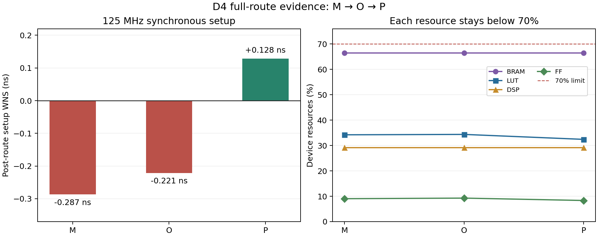

# D4 完整网络与 XC7Z020 实现结果（2026-10-19）

P 已形成可复核的完整网络 RTL 原型：完整功能回归、数字 reset 数据流和 125 MHz 同步 post-route 时序、资源、路由门通过；sample0 活动估算总片上功耗 0.613 W，完整窗口能效 18.35 GOPS/W。初始 20 GOPS/W 目标未通过，保留原阈值与负结果；网络、精度及统计口径保持。

## 网络与当前实现

D4 是 EdgeDSCNet-C10 主线；C0 保留为不同网络的冻结对照。D4 固定为 204,090 参数、10 个 MBConv、41 个算子、11,645,440 semantic MAC（23,290,880 ops）。INT8 软件 official test10k 为历史冻结结果 91.46%；本轮核对源身份，没有重跑 test10k。

当前硬件为 resident weights、128-bit 内部激活字和 32-bit 外部图像流。卷积采用 16 输出×4 输入并行计算、双 INT32 accumulator bank 与连续分组调度；RQ 使用保持完整精度的部分积流水，残差保留无损 signed9 表与 INT32 累加语义。3 个逻辑激活 slot 共用 6144×128 存储。P 将 FC ready 驱动移位改为静态队列索引读取，并保留每 lane 的本地 merge_valid FF，以控制扇出为主要优化对象；网络、权重和算术精度保持。

84 次完整推理覆盖 10 个真实类别样本和 4 种边界输入×3 种停顿模式×2 次启动；每次逐层检查 24,336 个中间字、10 个 raw INT32 FC accumulator 和完整 MAC 账本。启动、错误重启、在途复位、完成握手、连续启动及 ready 跨 reset/unlock 探针通过，94 条指标与 O 完全相同。算术穷举/单元证据按不变模块继承，未冒充本轮重跑。

## 初始评价基准与证据

| 项目 | P 当前结果 | 结论 |
| --- | --- | --- |
| 125 MHz post-route | 8 ns；WNS +0.128 ns、TNS 0；WHS +0.010 ns、THS 0 | 同步门通过；没有扫频推算极限 Fmax |
| 完整网络 RTL raw-FC 边界周期 | 无外部停顿 mode0：start-to-done 258,814；连续启动间隔 258,816 | RTL 边界 <2.0M cycles；125 MHz 下分别 2.070512/2.070528 ms；主机端到端待测 |
| LUT / FF | 17,239（32.40%）/8,864（8.33%） | 各 <70% |
| BRAM36 / DSP48E1 | 93（66.43%）/64（29.09%） | 各 <70% |
| 路由 | 25,587/25,587 可路由网全部完成，0 errors | 通过 |
| 活动估算总片上功耗 ≤3 W | 0.613 W total（dynamic 0.494 / static 0.120 W） | 通过；整体 Medium / I/O High，单sample0部分活动标注估算 |
| 真实网络吞吐的估算能效 ≥20 GOPS/W | 实际2.070696 ms窗口；11.247851 GOPS / 1.269337 mJ / 18.34886 GOPS/W | 初始目标未通过；全窗口保留reset/startup/completion |
| reset 后激活内存有效性 | 41descriptor/230,106次有效word读取，0读前未写；初始6144word任意 | 数字数据流通过；物理异步复位warning保留 |

工作频率下延迟由已验证 RTL cycles 换算，并非板上计时。raw FC 输出需要逐通道 scale ABI，不能直接 raw argmax；主机预处理、scale、分类与整机端到端延迟尚未测量，不能视为零。连续启动条件吞吐为 11.248764 GOPS；20 GOPS/W 对应每次推理能量上限 1.164544 mJ。本次能效使用整个实际 SAIF 窗口，包含捕获的 reset/startup/completion 开销；steady interval 另列，未替换分母。

## 活动功耗的覆盖与能量边界

本次只采集一个真实 sample0、mode0、epoch1 的完整 exact 推理。1.288 GB 新 VCD 为1 ps时间单位，实际末时间戳2,070,696,000 ps，原始SAIF只转换一次。native16项物理层级绑定和37项非时钟输入活动赋值通过。原始SAIF匹配1,006/45,420 nets，FD-Q alias导入报告9,112/45,420；重叠未知，未相加。Vivado最终显示20.06%网络匹配，未标注活动可采用默认传播；整体Medium置信度保留，不能当作完整网表活动覆盖或数据集平均。

计算为 `23,290,880 / (0.002070696 × 0.613 × 1e9) = 18.34886 GOPS/W`，能量为1.269337 mJ。达到20需同窗口总估算功耗≤0.562393 W，较本次少约50.6 mW（8.26%）。功耗组成包括MMCM0.106 W、signals0.118 W、slice logic0.091 W、BRAM0.084 W、DSP0.062 W、clocks0.032 W及device static0.120 W；各项独立四舍五入，总量使用报告Total0.613 W。BRAM减少的能效效果须另测，不能据tile数推导50.6 mW收益。

活动来自generic1:1 RTL时钟和锁定延迟模型；native在同一routed DCP上估算物理功耗，未模拟真实MMCM启动波形或测板级功耗。第一次native失败揭示SAIF字面实例名引用与wrapper时间戳收尾缺陷；只修复名称转义/错误记录，25测试通过后复用原SAIF做一次native修正，统计和DCP保持。首次失败文件与最终成功文件均保留。

## 从负结果得到的结构判断

M 将外部启动与核心控制解耦，但完整布线仍有 halo、ready 和 busy 路径违例。N/O 简化等价边界与冗余输入门控，消除了部分路径；O 仍暴露 ready 共享 CE（292 sinks）与跨 lane 合并 valid（960 sinks）。P 通过存储访问方式和局部控制改变这些网络：真实 routed 检查保留 16 个本地 valid FF，每路驱动本 lane 64 个 product CE；FC queue CE=288 与输出/index CE=40 分离。外部 ready 路径仍存在，其最差输入 setup 为 +0.301 ns。最差内部路径转为 weight_cursor 到权重 BRAM 地址。

这是累计候选比较，不是单因素消融。各点源于对应 parent acceptance，不能把 P 的 LUT/FF 总变化只归因于一个属性，也不能把旧候选的功耗套到 P。详细历史见 [开发记录](d4_fullnet_development_20261018.md)，结构与不变量见 [硬件结构](../d4_fullnet_architecture.md)。

## 证据入口、环境与后续方向

- 功能与综合：`build/reports/d4_fullnet_fc_static_local_ce_20261018/parent_acceptance.json`、`build/reports/d4_fullnet_synth_fc_static_local_ce_20261018/parent_synthesis_acceptance.json`。
- 完整物理：`build/reports/d4_fullnet_route_fc_static_local_ce_20261018/parent_route_acceptance.json`；routed DCP SHA256 `2D145331DCA7D8A12A399F45BEC746CEE6DCB147E1577BF551770A7F4A1AE1E6`。18 项最终源快照包含同源 RTL/TB 和 sample0 内存文件。
- reset与功耗验收入口：`build/reports/d4_p_reset_memory_audit_20261019/parent_acceptance.json`、`build/reports/d4_p_activity_power_20261019_contract/parent_acceptance.json`。根状态文件为 `build/reports/d4_fullnet_work_state.json`。
- 本地环境：Windows/PowerShell、Vivado 2025.2、XC7Z020CLG400-1；WSL Verilator 5.020/GCC 13.2.0，16 GB 主机以 jobs=2 编译、重型工具串行。XSim 使用共享锁；没有 Yosys。没有板级 pin LOC、bitstream 或上板验证。

本轮保留 P 作为已验收原型，并保留 20 GOPS/W 的负结果。后续优先扩充多样本活动与实际功耗覆盖，再选择结构实验；不把未经验证的资源变化当作能效收益。3 个物理激活 bank 可测试 BRAM 裕量，64 路8×8 MAC显式DSP映射可测试资源/能量取舍（额外64DSP后名义128/220=58.18%，仍需真实综合、DSP活动覆盖与P&R）；均未执行或宣称收益。板级 pin/PS/外存、真实时钟/异步复位电气签核、完整host ABI时延属于后续部署工作。

最终集成清单：`build/reports/d4_p_final_acceptance_20261019.json`。该清单明确 `initial_all_targets_pass=false`，未达初始能效目标；可复核的原型结果与后续部署工作分开记录。
